# Folder Spaces for VS Code

**Folder-scoped file explorer spaces: focus on one folder at a time without leaving your workspace.**

[繁體中文](README.zh-TW.md) · [简体中文](README.zh-CN.md) · [Changelog](CHANGELOG.md)

[](https://marketplace.visualstudio.com/items?itemName=edwardsayer.folder-spaces)
[](https://marketplace.visualstudio.com/items?itemName=edwardsayer.folder-spaces)
[](https://open-vsx.org/extension/edwardsayer/folder-spaces)
[](https://open-vsx.org/extension/edwardsayer/folder-spaces)
[](https://github.com/edwardsayer/code-folder-spaces/releases)
[](https://code.visualstudio.com/)
[](#known-limitations)
[](LICENSE)

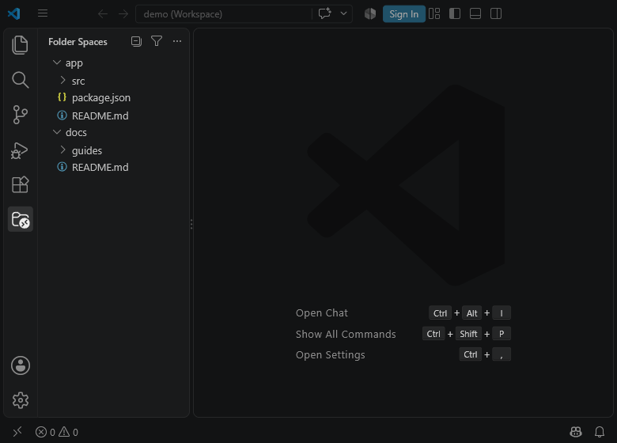

Folder Spaces adds dedicated, focused tree views to its own Activity Bar container, allowing you to work inside specific folders without the noise of the entire workspace. It uses native VS Code `TreeView` components: you retain file icon themes, Git status decorations, problem badges, native drag-and-drop, and full `workspace.fs` file operations.

## Install

### Visual Studio Code Marketplace

1. Open the Extensions view (`Ctrl+Shift+X` or `Cmd+Shift+X`).
2. Search for **Folder Spaces** and select **Install**, or install directly from the [VS Code Marketplace](https://marketplace.visualstudio.com/items?itemName=edwardsayer.folder-spaces).

Command line:

```bash
code --install-extension edwardsayer.folder-spaces
```

### Open VSX Registry

For VSCodium, Cursor, and other Open VSX-compatible editors, install from the [Open VSX Registry](https://open-vsx.org/extension/edwardsayer/folder-spaces):

```bash
codium --install-extension edwardsayer.folder-spaces
```

### Manual VSIX Installation

Download the latest `folder-spaces-<version>.vsix` from the release artifacts, then open the Command Palette (`Ctrl+Shift+P` / `Cmd+Shift+P`) and run **Extensions: Install from VSIX…**.

Once installed, click the **Folder Spaces** icon in the Activity Bar. You can add your first folder space using **Add Folder Space…** (`codeFolderSpaces.addSpace`) or by opening a folder/workspace.

## Core Layouts: Tree and Dual

Folder Spaces provides two primary layouts:

- **Tree Mode (Single Pane)**: Displays only the primary pane (**Spaces**). It supports multiple independent root folders side by side, making it ideal for standard navigation.
- **Dual Mode (Stacked Panes)**: Stacks the primary pane (**Spaces**) on top and the secondary pane (**Files**) on the bottom.

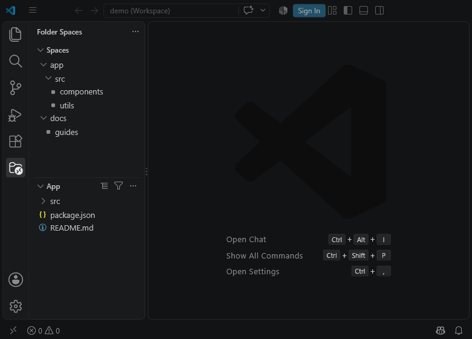

| Feature | **Spaces** (Pane 1) | **Files** (Pane 2) |
|---|---|---|
| Role | Primary navigation and control center | Secondary file and detail listing |
| Title Bar Actions | Collapse All / Expand Level, Filter, `…` Menu | View Mode, Filter, `…` Menu |
| Roots | Workspace folders, configured spaces, global roots | Folder cascaded from Spaces or set via inline action |
| Can Be Closed | No (primary pane) | Yes (closing returns to Tree mode) |

- **Adaptive Titles**: In Dual mode, Pane 1 is titled **Spaces** when it has multiple roots and is not drilled down; when drilled down or showing a single root, it displays the folder's name. Pane 2 displays the active folder's name.
- **Folder Cascade**: In Dual mode, selecting any directory in Pane 1 automatically cascades that folder into Pane 2 as its active root.

### Dual Visibility-Aware Layout

The `Dual Pane` and `Dual Pane ✓` menu items exist on **both** panes and synchronize with actual UI visibility:

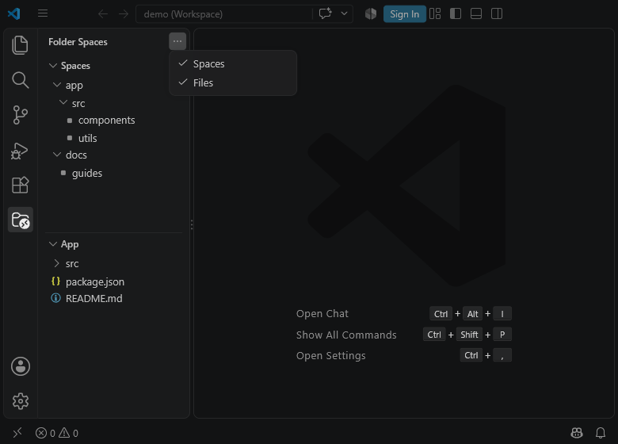

- When both panes are open in Dual mode, the pane menus show **Dual Pane ✓**. Clicking it closes Pane 2 and returns to Tree mode.
- If either pane is hidden using the Activity Bar container's `…` menu, the remaining pane displays an unchecked **Dual Pane** option. Clicking it immediately unhides and restores the missing pane.

## Files Pane View Modes

In Dual mode, the **Files** pane title bar features a single-button mode switcher (`codeFolderSpaces.pane2.toggleViewMode`) that cycles through three distinct view modes:

| View Mode | Title Bar Button | Description |
|---|---|---|
| **Explorer** (Default) | `$(list-tree)` | Full tree structure with directories and files, in-place drill-down, and leaf folder indicators. |
| **File List** | `$(list-flat)` | Flat listing of first-level direct files only, excluding subfolders. |
| **Nested File List** | `$(layers)` | Flattened recursive listing of all files across all subdirectories, bounded by `maxDepth`. |

<p>
  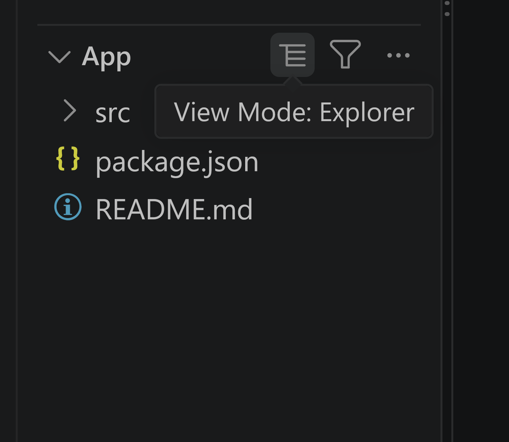
  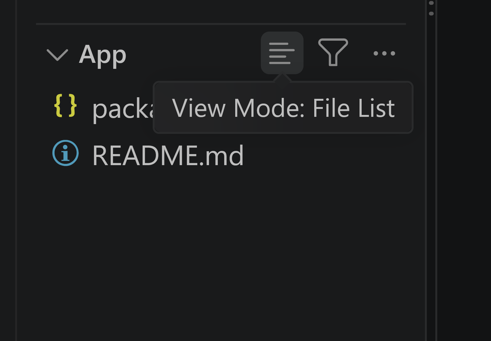
  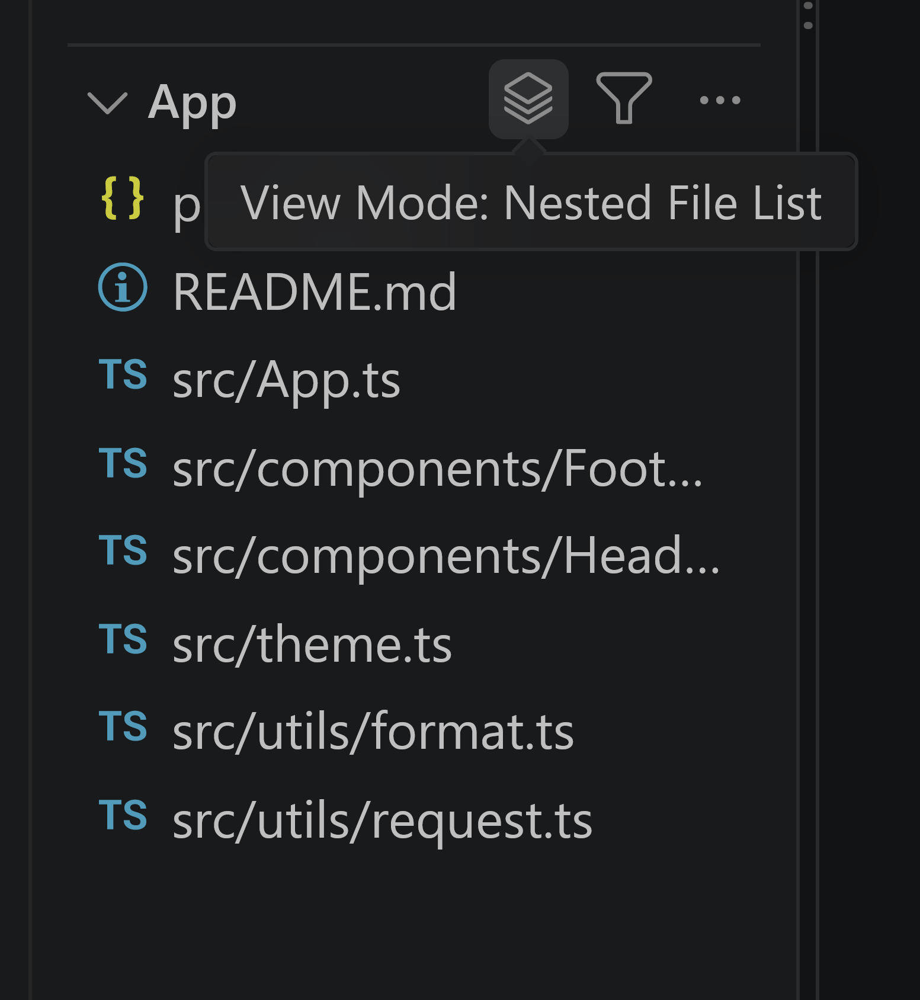
</p>

## In-Place Navigation & Multiple Roots

### In-Place Drill Down

Click the **Drill Into Folder** (`$(arrow-down)`) inline button on any directory row to temporarily promote that directory as the pane's root. Drill-down maintains your active view preset.

When drilled down, a **Return to Parent** (`$(arrow-up)`) action appears in the pane title bar, allowing you to navigate back through the drill stack to the root folder.

### Activate Child Space

On any folder row in Pane 1, click the **Activate Child Space** (`$(arrow-right)`) inline button. This immediately assigns the selected folder as Pane 2's root and opens Dual mode if the extension is currently in Tree mode.

### Multiple Roots & Candidate Picker

You can add multiple independent roots to Pane 1:

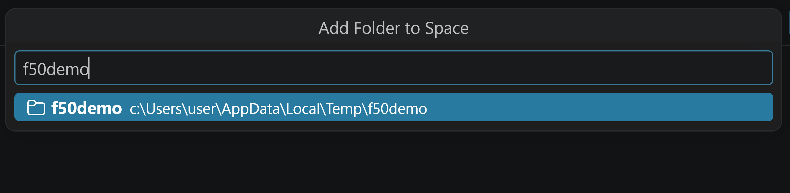

- Use **Add Folder to Space…** in the pane `…` menu to open a searchable picker. It automatically suggests parent folders and recently opened directories, and provides a **Browse for folder…** dialog option.
- When two or more roots are displayed in a pane, each root row displays a **Remove Folder from Space** (`$(close)`) inline button. For safety, the last remaining root cannot be removed.

## Menus, Sorting & State Checkmarks

Stateful menu items use paired commands with a trailing **✓** because VS Code does not provide native checkmarks for extension menus:

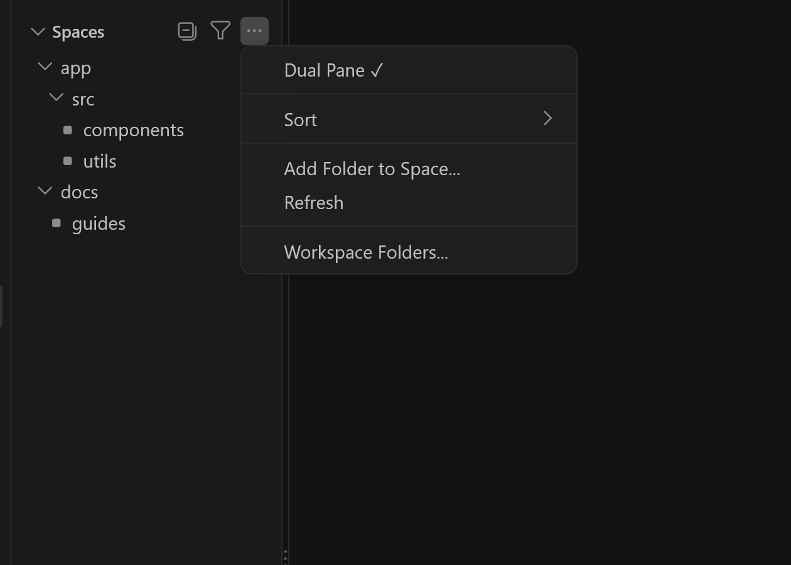

The pane title menu (`…`) gives access to:
- **Dual Pane** / **Dual Pane ✓**: Toggle between Tree mode and Dual mode.
- **Sort**: Opens the sorting submenu.
- **Add Folder to Space…**: Add another root to the current pane.
- **Refresh**: Re-read the file system and update the tree.
- **Workspace Folders…**: Select which workspace folders should be visible in the pane.

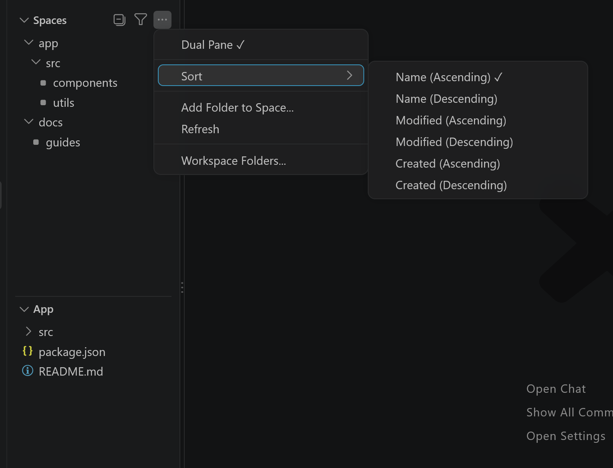

The **Sort** submenu provides independent ordering controls for each pane:
- **Name (Ascending / Descending)**
- **Modified (Ascending / Descending)**
- **Created (Ascending / Descending)**

## Path Filtering

Click the **Filter by Path…** (`$(filter)`) action in the title bar to filter entries by a substring:

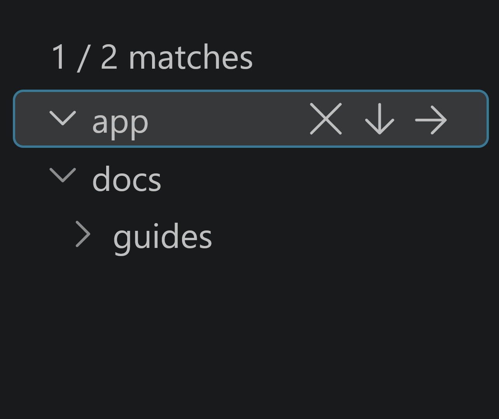

- A match counter (e.g., `1 / 2 matches`) appears in the pane view banner.
- While filtered, the button toggles to **Clear Filter** (`$(clear-all)`), enabling one-click filter reset.

## Managing Spaces: Workspace vs Global

Roots are managed across two distinct scopes:

1. **Workspace Spaces** (`codeFolderSpaces.spaces.workspace`): Project-specific roots stored in `.vscode/settings.json` or your `.code-workspace` configuration.
2. **Global Spaces** (`codeFolderSpaces.spaces.global`): Profile-level roots stored in user settings. They appear across all workspaces in the current profile and are marked with a **🌐** badge.

### Context Menu Integration

Right-click any root entry to migrate it between scopes:
- **Mark as Global**: Moves a workspace root to your global user settings.
- **Unmark Global**: Moves a global root into the local workspace configuration.

You can also right-click any folder in VS Code's built-in File Explorer and choose **Open in Folder Spaces** (`codeFolderSpaces.openInFolderSpaces`) to immediately bring it into Pane 1.

## File Operations & Safety

Folder Spaces includes full file manipulation capabilities:

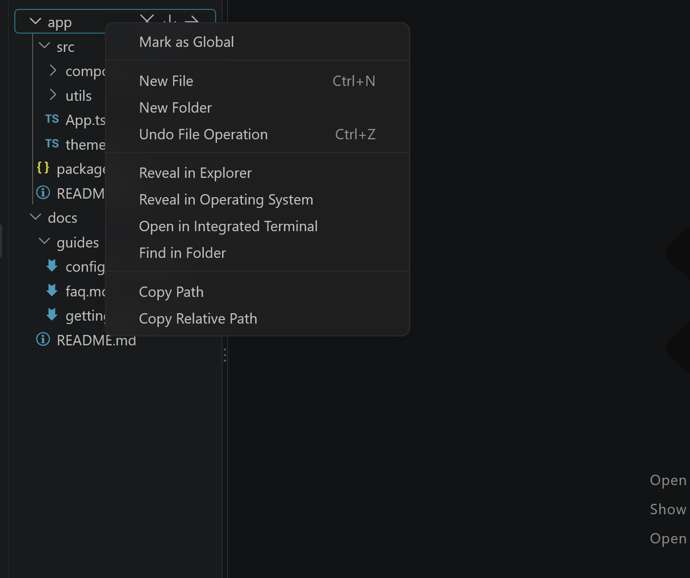

### Keyboard Shortcuts

File operations use context-aware keybindings matching native Explorer shortcuts:

| Shortcut | Command | Action |
|---|---|---|
| `Ctrl+C` / `Cmd+C` | `codeFolderSpaces.copyEntry` | Copy selected file or folder |
| `Ctrl+X` / `Cmd+X` | `codeFolderSpaces.cutEntry` | Cut selected file or folder |
| `Ctrl+V` / `Cmd+V` | `codeFolderSpaces.pasteEntries` | Paste items into target directory |
| `F2` | `codeFolderSpaces.renameEntry` | Rename selected file or folder |
| `Delete` | `codeFolderSpaces.deleteEntry` | Delete selected entry (respects trash settings) |
| `Ctrl+Z` / `Cmd+Z` | `codeFolderSpaces.undoFileOperation` | Undo last rename or move operation |

### Safety Guardrails

- **Workspace Trust**: In Restricted Mode, file modifications (create, rename, move, delete, drop) are disabled. Safe operations (browsing, opening files, copying paths) remain available.
- **Dedicated Undo Stack**: Tracks up to 20 recent move and rename operations made within Folder Spaces, independent of VS Code's editor undo history.
- **Trash Integration**: When `files.enableTrash` is enabled, deletions on local file systems move items to the OS trash bin.
- **Native Drag & Drop**: Dragging items within the same space moves them; dragging across different space roots copies them safely.

## Visibility & File Nesting

Folder Spaces automatically respects your VS Code environment settings:

- **Explorer Exclude Rules**: Automatically applies `files.exclude` patterns (such as `.git`, `node_modules`).
- **Git Ignore**: When `explorer.excludeGitIgnore` is true, entries matched by `.gitignore` rules are hidden.
- **File Nesting**: Seamlessly integrates with `explorer.fileNesting.enabled`, `patterns`, and `expand` settings, nesting child files (such as `.d.ts` or test files) under their parent files.

## Settings Reference

| Setting | Type | Default | Description |
|---|---|---|---|
| `codeFolderSpaces.spaces.workspace` | `array` | `[]` | Workspace-level folder spaces. Array of paths or configuration objects. |
| `codeFolderSpaces.spaces.global` | `array` | `[]` | Profile-level folder spaces (application scope). Stored in user settings. |
| `codeFolderSpaces.followActiveFile` | `boolean` | `true` | Automatically reveal and select the active editor file in the tree. |
| `codeFolderSpaces.maxDepth` | `integer` | `10` | Maximum folder depth (1–100) enumerated by recursive flat listings. |
| `codeFolderSpaces.followWorkspaceDirectory` | `boolean` | `true` | Synchronize pane roots with workspace folders while preserving configured spaces. |
| `codeFolderSpaces.defaultPreset.singlePane` | `string` | `"Explorer"` | Default view preset for Pane 1 in Single Pane (Tree) mode. |
| `codeFolderSpaces.defaultPreset.dualPane.pane1` | `string` | `"Navigate"` | Default view preset for Pane 1 when entering Dual mode. |
| `codeFolderSpaces.defaultPreset.dualPane.pane2` | `string` | `"Explorer"` | Default view preset for Pane 2 when entering Dual mode. |

### Configuration Example

```jsonc
{
  "codeFolderSpaces.spaces.workspace": [
    "${workspaceFolder}/src",
    {
      "path": "${workspaceFolder}/docs",
      "name": "Documentation",
      "icon": "book",
      "include": ["**/*.md"],
      "exclude": ["**/drafts/**"]
    }
  ],
  "codeFolderSpaces.spaces.global": [
    "${userHome}/notes"
  ],
  "codeFolderSpaces.followActiveFile": true,
  "codeFolderSpaces.maxDepth": 15
}
```

Configured space objects support:
- `path` (string, required): Directory path. Supports `${workspaceFolder}`, `${workspaceFolders[N]}`, and `${userHome}`.
- `name` (string): Custom display name.
- `icon` (string): ThemeIcon ID (e.g. `folder`, `book`) or an absolute path to an icon file.
- `include` (string[]): Glob patterns to whitelist files.
- `exclude` (string[]): Glob patterns to blacklist files and folders.

## Commands Reference

| Command ID | Title | Shortcut | Placement |
|---|---|---|---|
| `codeFolderSpaces.addSpace` | Add Folder Space... | — | Command Palette, Views Welcome |
| `codeFolderSpaces.pane1.addRoot` | Add Folder to Space... | — | Spaces Pane `…` Menu |
| `codeFolderSpaces.drillDown` | Drill Into Folder | — | Directory Row Inline (`$(arrow-down)`) |
| `codeFolderSpaces.activateChildNode` | Activate Child Space | — | Pane 1 Folder Inline (`$(arrow-right)`) |
| `codeFolderSpaces.pane1.drillUp` | Return to Parent | — | Pane 1 Title Bar (`$(arrow-up)`) |
| `codeFolderSpaces.pane2.drillUp` | Return to Parent | — | Pane 2 Title Bar (`$(arrow-up)`) |
| `codeFolderSpaces.pane2.toggleViewMode` | Toggle View Mode | — | Pane 2 Title Bar |
| `codeFolderSpaces.filter` | Filter by Path... | — | Pane Title Bar (`$(filter)`) |
| `codeFolderSpaces.clearFilter` | Clear Filter | — | Pane Title Bar (`$(clear-all)`) |
| `codeFolderSpaces.copyEntry` | Copy | `Ctrl+C` / `Cmd+C` | Context Menu / Keybinding |
| `codeFolderSpaces.cutEntry` | Cut | `Ctrl+X` / `Cmd+X` | Context Menu / Keybinding |
| `codeFolderSpaces.pasteEntries` | Paste | `Ctrl+V` / `Cmd+V` | Context Menu / Keybinding |
| `codeFolderSpaces.renameEntry` | Rename | `F2` | Context Menu / Keybinding |
| `codeFolderSpaces.deleteEntry` | Delete | `Delete` | Context Menu / Keybinding |
| `codeFolderSpaces.undoFileOperation` | Undo File Operation | `Ctrl+Z` / `Cmd+Z` | Context Menu / Keybinding |
| `codeFolderSpaces.openInFolderSpaces` | Open in Folder Spaces | — | Built-in Explorer Context Menu |
| `codeFolderSpaces.openWorkspace` | Open Workspace | — | `.code-workspace` Row Inline |
| `codeFolderSpaces.openWorkspaceInNewWindow` | Open Workspace in New Window | — | `.code-workspace` Row Inline |
| `codeFolderSpaces.root.markAsGlobal` | Mark as Global | — | Root Row Context Menu |
| `codeFolderSpaces.root.unmarkGlobal` | Unmark Global | — | Global Root Row Context Menu |

## Known Limitations

- **Fixed Two-Pane Architecture**: Folder Spaces provides up to two panes (Spaces and Files). Pane 1 cannot be closed; closing Pane 2 returns the layout to Tree mode.
- **Local Filesystem Requirement**: Requires accessible local directory paths. Virtual workspaces are not supported.
- **Glob Pattern Syntax**: Glob filtering supports `*`, `**`, `**/`, `?`, and escaping. Character ranges or brace expansions are not supported.
- **Platform Path Case Sensitivity**: Path comparison is case-insensitive on Windows and case-sensitive on Linux/macOS.

## Development

```bash
npm install
npm run check          # typecheck, unit tests, build, project checks and command parity
npm run watch          # esbuild watch
npm run package:vsix   # production bundle + vsce package
```

To run the extension in an isolated Extension Development Host:

```bash
npm run vscode:debug -- --extension ./code-folder-spaces
```

## License

MIT — see [LICENSE](LICENSE).
