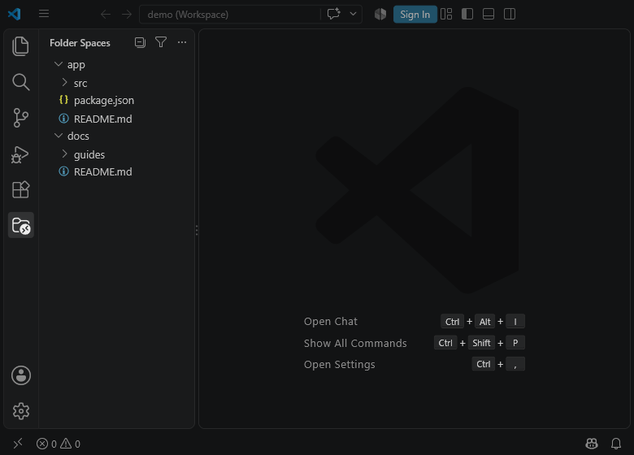
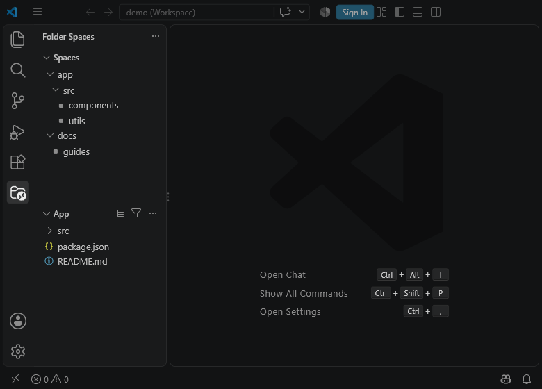
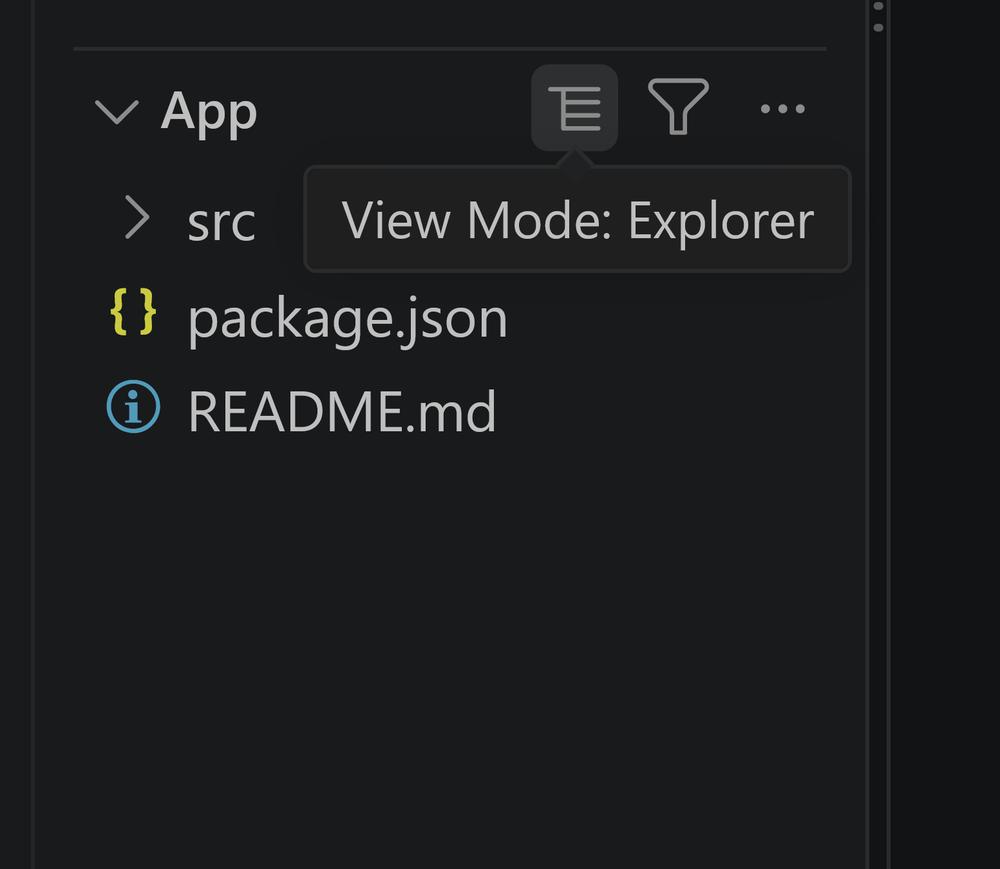
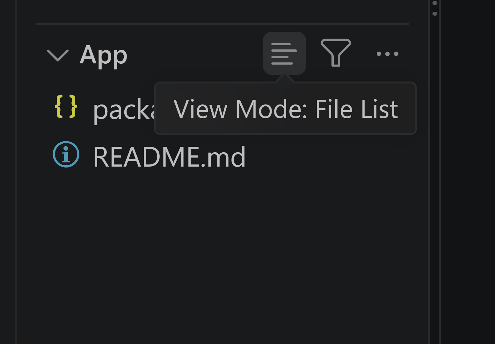
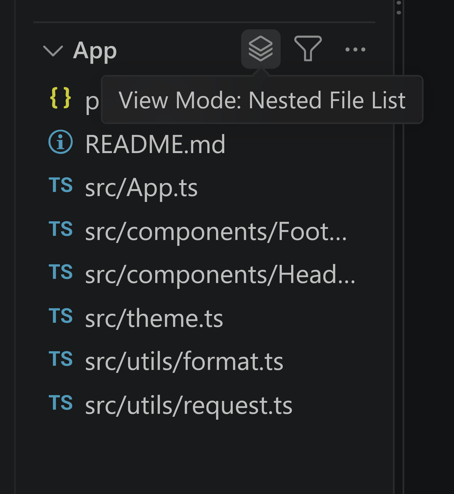
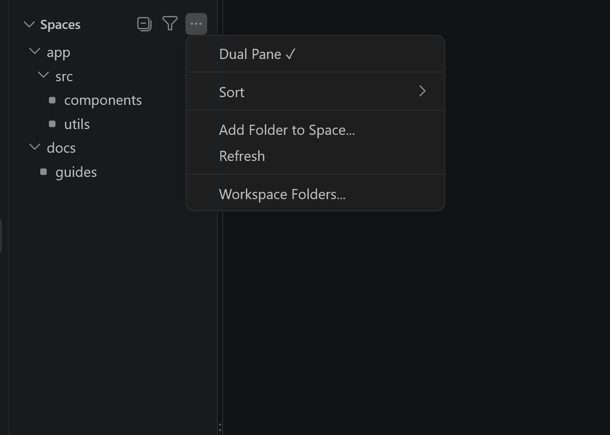
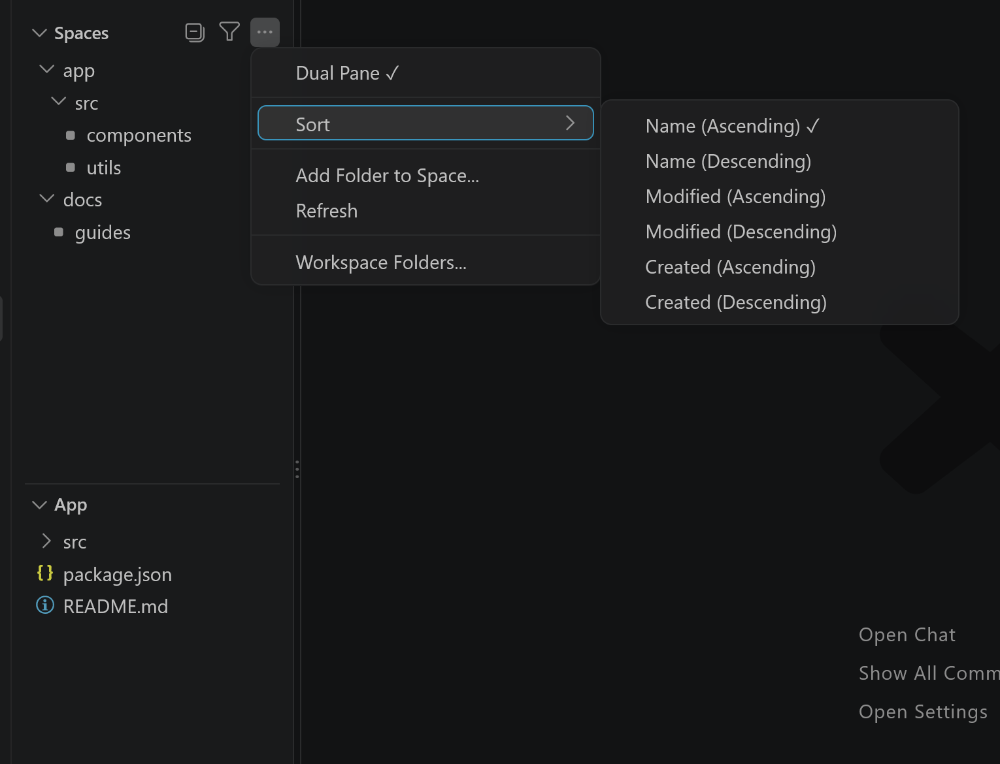
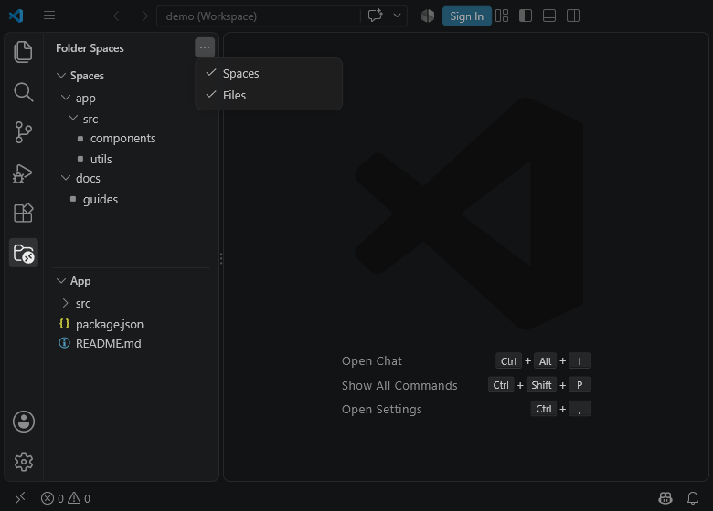
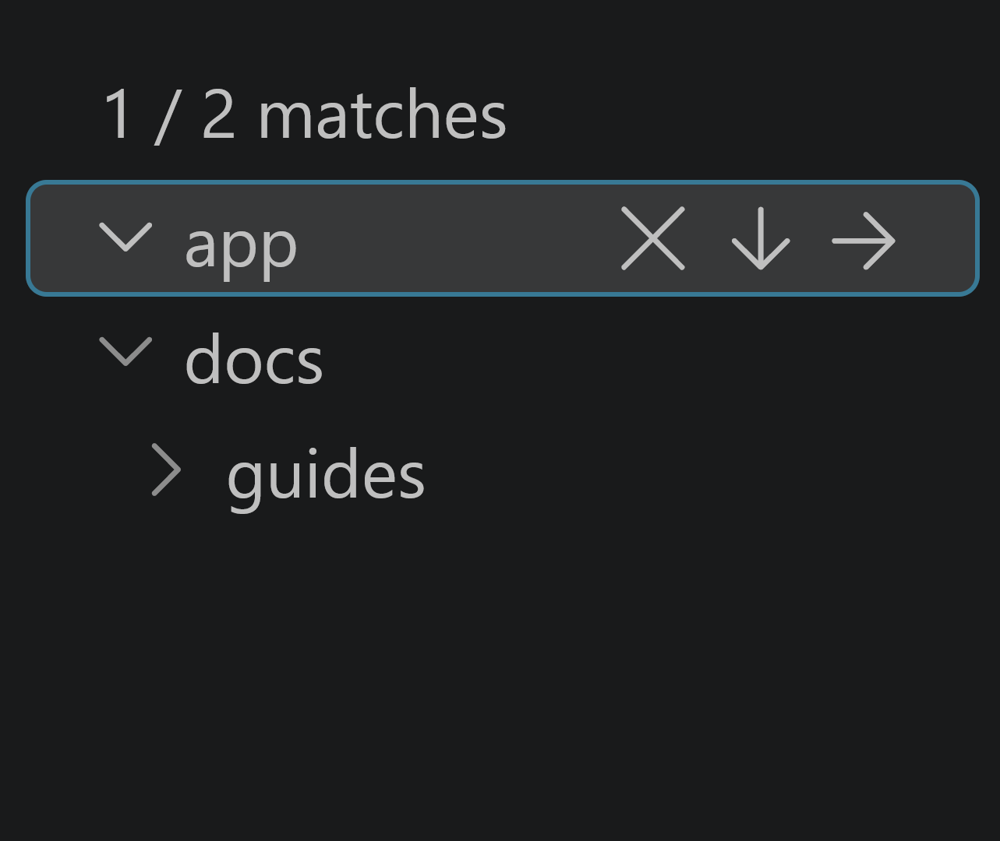
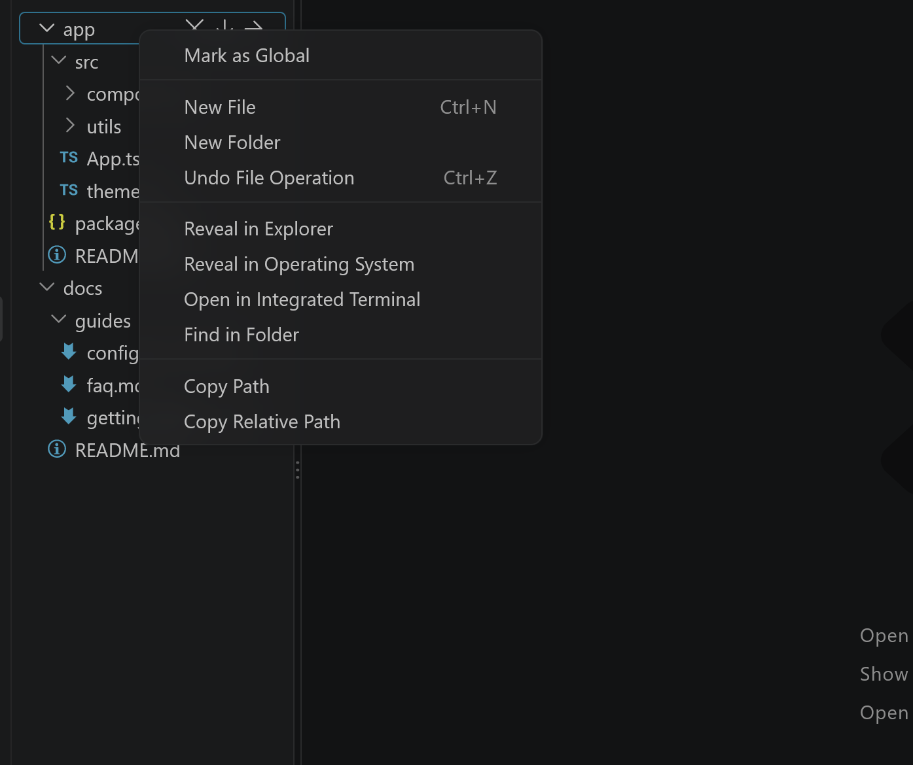

# Folder Spaces for VS Code

**Focused, folder-scoped file navigation for Visual Studio Code.**

Folder Spaces adds one or two native tree views to its own Activity Bar container, so you can work inside the folders you care about without the noise of the whole workspace. It is a normal `TreeView`: you keep native file icons, Git decorations, problem badges, file operations and `workspace.fs` support.

[繁體中文](README.zh-TW.md) · [简体中文](README.zh-CN.md) · [Changelog](CHANGELOG.md)



> **Version 0.2.0.** Two layouts are supported: **Tree** (one pane) and **Dual** (two stacked panes). Read [Breaking changes from v1.x](#breaking-changes-from-v1x) before upgrading.

## Why Folder Spaces

VS Code's built-in Explorer always shows the entire workspace. Folder Spaces gives you a focused view of selected folders — and of a *second* folder at the same time — while keeping everything native.

## Tree mode

Tree mode is a single pane. Each configured root is listed as a top-level row, and several roots can be shown side by side.

- The pane title is the container title **Folder Spaces**; no description is set.
- Every folder row carries two inline buttons: **Drill Into Folder** and **Activate Child Space**.
- The title bar holds **Collapse All / Expand Level**, **Filter by Path… / Clear Filter** and the `…` menu (**Dual Pane**, **Sort**, **Add Folder to Space…**, **Refresh**, **Workspace Folders…**).

## Dual mode



Dual mode stacks two panes:

| | **Spaces** (pane1) | **Files** (pane2) |
|---|---|---|
| Role | Control center | Secondary listing |
| Title bar | Collapse All / Expand Level, Filter, `…` menu | View Mode, Filter, `…` menu |
| Roots | All configured roots | Only the folder cascaded from pane1 |
| Can be closed | No | Yes — closing it returns to Tree mode |

- Titles follow content: pane1 shows **Spaces** when it has several roots and no drill-down, otherwise the last path segment; pane2 shows its current folder.
- Selecting a **folder** in pane1 navigates pane2 into it (selecting a file does not).
- **Activate Child Space** on a folder row makes that folder pane2's root and opens Dual mode if needed.
- Pane1 and pane2 remember their own view and sort settings.

### Files pane view modes

The **View Mode** button on the Files pane cycles through three modes:

| Mode | Button | Shows |
|---|---|---|
| Explorer (default) | `$(list-tree)` | Local tree with drill-down and folder end points |
| File List | `$(list-flat)` | First-level files only |
| Nested File List | `$(layers)` | Files from every level, flattened |





### Dual Pane is visibility-aware

`Dual Pane` / `Dual Pane ✓` exist on **both** panes and reflect what is actually on screen:

- Both panes visible and mode is Dual → the menu shows **Dual Pane ✓**; activating it closes Files and returns to Tree.
- Either pane is hidden from the container menu → the remaining pane shows an unchecked **Dual Pane**; activating it unhides and restores the missing pane.
- Collapsing a pane by clicking its title bar is *not* the same as closing it: the pane stays alive and simply expands again on the next click.

## Menus and check marks



Stateful items are shown as paired commands with a trailing **✓** (for example `Dual Pane ✓`), because VS Code does not render native check marks for extension menus.



The **Sort** submenu offers Name / Modified / Created, ascending and descending, and each pane keeps its own choice. The container's `…` menu lists the views (**Spaces**, **Files**) and can hide either one.



## Filtering



**Filter by Path…** applies a path-substring filter to the pane and shows a `n / m matches` counter plus an inline **Clear Filter** button. Supported glob syntax for `include` / `exclude` covers `*`, `**`, `**/`, `?` and escaping; brace patterns and character classes are not supported.

## Where roots come from

Roots can come from three sources, kept separate on purpose:

1. **Workspace roots** — available automatically from the current VS Code workspace. They can be hidden and restored from **Workspace Folders…**.
2. **`codeFolderSpaces.spaces.workspace`** — project-level list, written to `.vscode/settings.json` or to the `.code-workspace` file.
3. **`codeFolderSpaces.spaces.global`** — profile-level list in your user `settings.json`, shown in every window of that profile and marked with **🌐**.

Use **Mark as Global** / **Unmark Global** on a root to move it between the project list and the global list. Profiles keep separate settings, so other profiles need their own global roots (or Settings Sync).

## File operations



- Create, rename, delete, move and drag-and-drop, plus a session-scoped undo for move/rename.
- Disk-modifying commands are gated by Workspace Trust: they stay disabled until the workspace is trusted.
- When `files.enableTrash` is on, deletes go through the trash for `file:` URIs; other schemes are refused rather than deleted permanently.
- Live file-system watchers keep the panes up to date, including folders outside the workspace.

## Settings

| Setting | Type | Default | Description |
| --- | --- | --- | --- |
| `codeFolderSpaces.spaces.workspace` | array | `[]` | Project/workspace-level roots. Entries are paths or objects. |
| `codeFolderSpaces.spaces.global` | array | `[]` | Profile-level roots (target of **Mark as Global**); user settings only. |
| `codeFolderSpaces.followActiveFile` | boolean | `true` | Follow the active editor file in the space tree. |
| `codeFolderSpaces.maxDepth` | integer (1–100) | `10` | Maximum folder depth enumerated by flat listings. |
| `codeFolderSpaces.followWorkspaceDirectory` | boolean | `true` | Keep pane1's workspace roots synchronized with workspace folders; configured and global roots are preserved and appended. |
| `codeFolderSpaces.defaultPreset.singlePane` | string | `Explorer` | View used when switching to Tree mode. |
| `codeFolderSpaces.defaultPreset.dualPane.pane1` | string | `Navigate` | View used for Spaces when entering Dual mode. |
| `codeFolderSpaces.defaultPreset.dualPane.pane2` | string | `Explorer` | View used for Files when entering Dual mode. |

A root entry may be a path string or an object with `path`, `name`, `icon`, `showFiles`, `include` and `exclude`. Paths support `${workspaceFolder}`, `${workspaceFolders[N]}` and `${userHome}`.

```jsonc
{
  "codeFolderSpaces.spaces.workspace": [
    "${workspaceFolder}/src",
    {
      "path": "${workspaceFolder}/docs",
      "name": "Documentation",
      "icon": "book",
      "showFiles": true,
      "exclude": ["archive/**"]
    }
  ],
  "codeFolderSpaces.spaces.global": ["${userHome}/notes"]
}
```

## Common commands

Most pane actions live in the title bar, the `…` menu, the **Sort** submenu or the context menu, and are hidden from the Command Palette on purpose.

- **Drill Into Folder**, **Activate Child Space** — inline buttons on every folder row in pane1.
- **Add Folder to Space…** — a single searchable picker with recent folders and a **Browse for folder…** entry; a typed path is accepted directly.
- **Remove Root**, **Workspace Folders…**, **Refresh**.
- **Dual Pane** / **Dual Pane ✓**, **Close Pane**.
- **Collapse All**, **Expand Level**, **Filter by Path…**, **Clear Filter**, **Return to Parent**.
- **Toggle View Mode** — Files pane: Explorer / File List / Nested File List.
- **Mark as Global**, **Unmark Global**.
- **Open Workspace**, **Open Workspace in New Window** — inline buttons on `.code-workspace` rows.

The manifest currently contributes **86** commands; all of them are covered by a command-parity check.

## File nesting

File nesting follows VS Code's own `explorer.fileNesting.enabled`, `patterns` and `expand` settings. It applies to sibling files in one directory, each file gets at most one parent, and a path filter disables nesting. Note that `explorer.fileNesting.patterns` from Global and Workspace scopes are merged with the built-in defaults.

## Known limitations

- Pane1 cannot be closed; closing pane2 returns to Tree mode.
- Glob support is a subset (`*`, `**`, `**/`, `?`, escaping); `src/**` does not match the `src` directory itself.
- Move safety uses lexical path comparison and does not resolve symlinks.
- Virtual workspaces are not supported; remote environments have not been fully validated.
- Pane titles are subject to VS Code's native `text-transform: capitalize`, which an extension cannot override.

## Breaking changes from v1.x

Version 0.1.0 replaces the former multi-pane/preset model with fixed **Tree** and **Dual** layouts, removes the old `codeFolderSpaces.spaces` setting without migrating it, and removes preset controls and several settings. See [CHANGELOG.md](CHANGELOG.md) for the full list.

## Development

```bash
npm install
npm run check          # typecheck, unit tests, build, project checks and command parity
npm run watch          # esbuild watch
npm run package:vsix   # production bundle + vsce package
```

Run the extension with F5 (**Run Extension**) or load it into an isolated window:

```bash
npm run vscode:debug -- --extension ./code-folder-spaces
```

## License

MIT — see [LICENSE](LICENSE).
