# Folder Spaces for VS Code

**文件夹范围的资源管理器空间：一次专注于一个文件夹，无需离开当前工作区。**

[English](README.md) · [繁體中文](README.zh-TW.md) · [Changelog](CHANGELOG.md)

[](https://marketplace.visualstudio.com/items?itemName=edwardsayer.folder-spaces)
[](https://marketplace.visualstudio.com/items?itemName=edwardsayer.folder-spaces)
[](https://open-vsx.org/extension/edwardsayer/folder-spaces)
[](https://open-vsx.org/extension/edwardsayer/folder-spaces)
[](https://github.com/edwardsayer/code-folder-spaces/releases)
[](https://code.visualstudio.com/)
[](#known-limitations)
[](LICENSE)

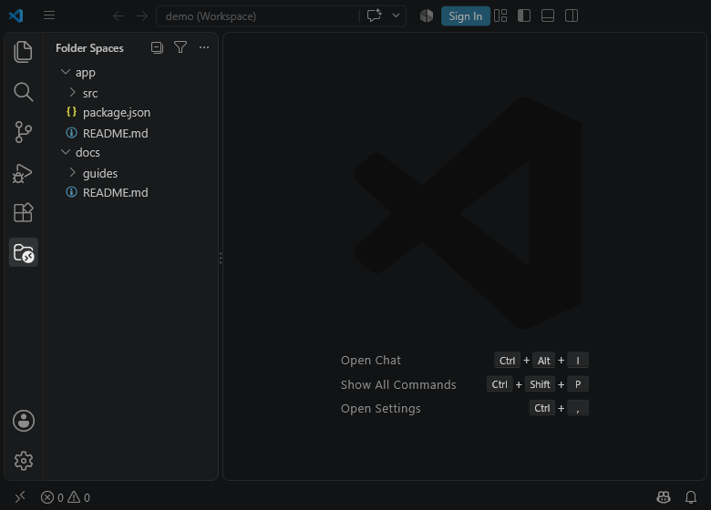

Folder Spaces 在专属的 Activity Bar 容器中提供聚焦的树状视图，让你可以专注于关心的特定文件夹，免去整个工作区的杂讯干扰。它采用 VS Code 原生 `TreeView` 组件：完整保留文件图标主题、Git 状态装饰、诊断问题标记、原生拖放操作与 `workspace.fs` 文件操作支持。

## Install

### Visual Studio Code Marketplace

1. 打开扩展视图（`Ctrl+Shift+X` 或 `Cmd+Shift+X`）。
2. 搜索 **Folder Spaces** 并选择 **安装**，或直接前往 [VS Code Marketplace 页面](https://marketplace.visualstudio.com/items?itemName=edwardsayer.folder-spaces)。

命令行安装：

```bash
code --install-extension edwardsayer.folder-spaces
```

### Open VSX Registry

使用 VSCodium、Cursor 等兼容 Open VSX 的编辑器时，可以直接在 [Open VSX Registry](https://open-vsx.org/extension/edwardsayer/folder-spaces) 安装：

```bash
codium --install-extension edwardsayer.folder-spaces
```

### 手动安装 VSIX

从发布产物下载最新版 `folder-spaces-<version>.vsix`，接着打开命令面板（`Ctrl+Shift+P` / `Cmd+Shift+P`）并运行 **Extensions: Install from VSIX…**。

安装完成后，点击 Activity Bar 上的 **Folder Spaces** 图标。你可以使用 **添加文件夹空间...**（`codeFolderSpaces.addSpace`）或打开文件夹／工作区来加入第一个文件夹空间。

## Core Layouts: Tree and Dual

Folder Spaces 提供两种核心布局模式：

- **Tree 模式（单窗格）**：仅显示主窗格（**Spaces**）。支持同时并列呈现多个独立根目录，适合标准单一视图导航。
- **Dual 模式（双窗格叠加）**：上方为主窗格（**Spaces**），下方为次窗格（**Files**）。

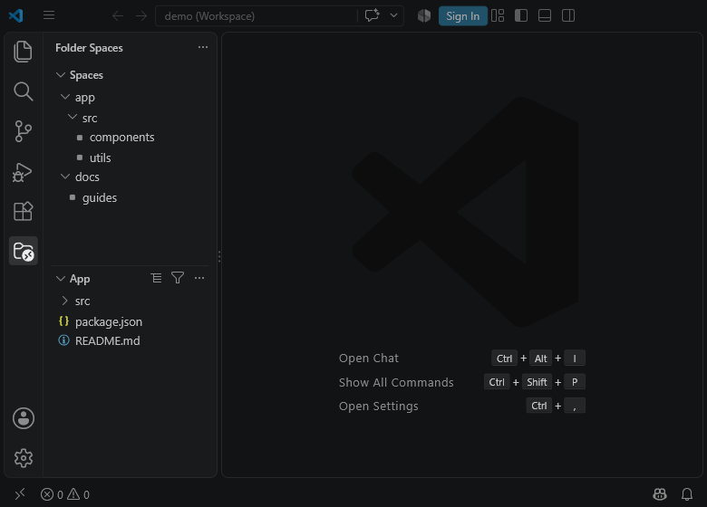

| 功能特性 | **Spaces**（窗格 1） | **Files**（窗格 2） |
|---|---|---|
| 角色职责 | 主要导航与控制中心 | 次要文件与细节内容列表 |
| 标题栏动作 | 全部折叠 / 展开级别、筛选、`…` 菜单 | 切换视图模式、筛选、`…` 菜单 |
| 根目录来源 | 工作区文件夹、已配置空间、全局空间 | 由 Spaces 窗格级联联动或行内按钮指定 |
| 可否关闭 | 否（主控制窗格） | 是（关闭时退回 Tree 模式） |

- **自适应标题**：在 Dual 模式下，Spaces 窗格若有多个根且未深入时标题显示为 **Spaces**；单一根或深入时显示该目录原生名称。Files 窗格显示当前所属目录名称。
- **文件夹级联联动**：在 Dual 模式下，在 Spaces 窗格点击任何文件夹时，系统会自动将其设为 Files 窗格的当前根目录。

### Dual Visibility-Aware Layout

`Dual Pane` 与 `Dual Pane ✓` 菜单项同时存在于**两个窗格**中，并与实际界面可见性实时同步：

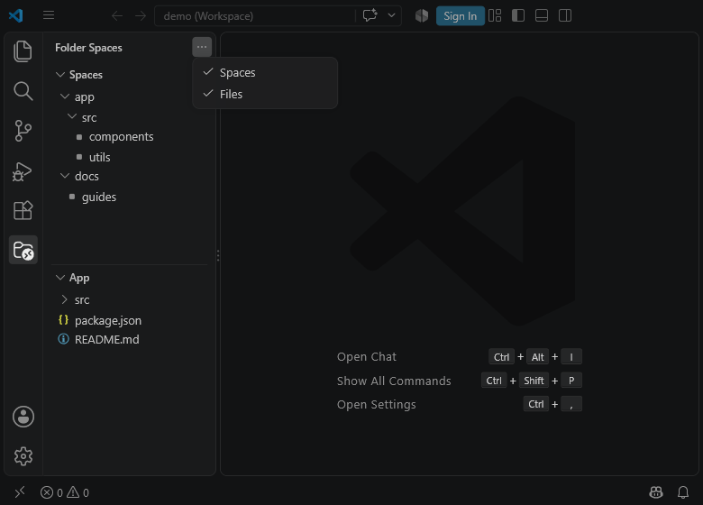

- 双窗格同时打开且处于 Dual 模式时，窗格菜单显示 **Dual Pane ✓**。点击即可关闭 Files 窗格并退回 Tree 模式。
- 若任一窗格在 Activity Bar 容器标题菜单中被手动隐藏，留存的窗格会呈现未勾选的 **Dual Pane**。点击即可立即取消隐藏并召回消失的窗格。

## Files Pane View Modes

在 Dual 模式下，**Files** 窗格标题栏提供单键循环切换按钮（`codeFolderSpaces.pane2.toggleViewMode`），支持在三种视图形态间切换：

| 视图模式 | 标题栏按钮 | 模式说明 |
|---|---|---|
| **Explorer**（默认） | `$(list-tree)` | 完整资源管理器树状结构，包含目录与文件，支持就地深入与端点文件夹指示标记。 |
| **File List** | `$(list-flat)` | 第一层直属文件扁平列表，不含子文件夹。 |
| **Nested File List** | `$(layers)` | 跨层级递归扁平文件列表，展开所有子目录深处的文件，受 `maxDepth` 限制。 |

<p>
  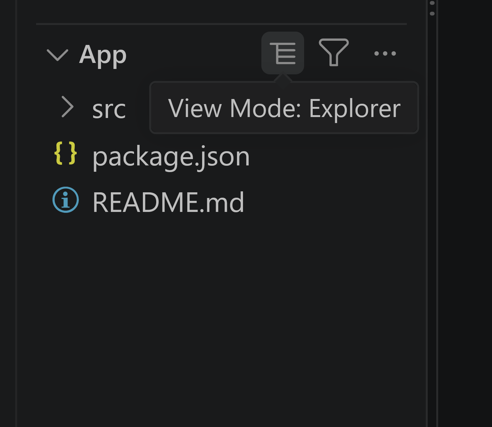
  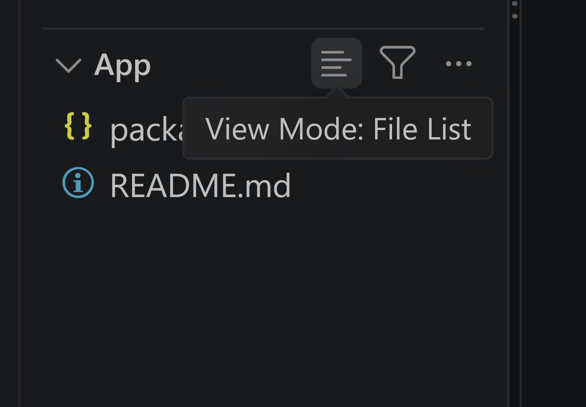
  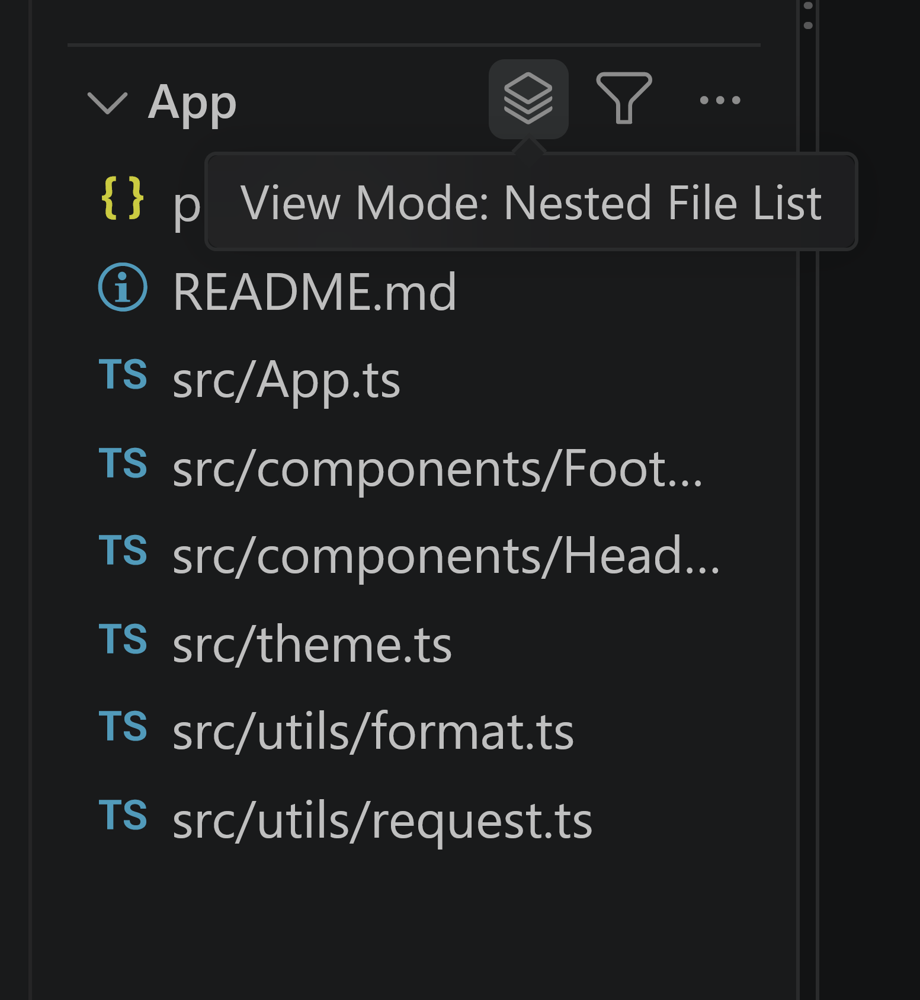
</p>

## In-Place Navigation & Multiple Roots

### In-Place Drill Down

点击任一文件夹行右侧的 **就地深入**（`$(arrow-down)`）行内按钮，可将该目录临时提升为当前窗格的根目录。就地深入会保留现有的视图模式设置。

深入后，窗格标题栏会出现 **返回上一级**（`$(arrow-up)`）按钮，点击即可依次沿着堆栈退回上一层目录或原始根目录。

### Activate Child Space

在 Spaces 窗格的任一文件夹行上，点击 **激活子空间**（`$(arrow-right)`）行内按钮，可立即将选中的文件夹设为 Files 窗格的根目录；若当前处于 Tree 模式，系统会自动打开 Dual 双窗格布局。

### Multiple Roots & Candidate Picker

Spaces 窗格支持同时加入多个彼此独立的根目录：

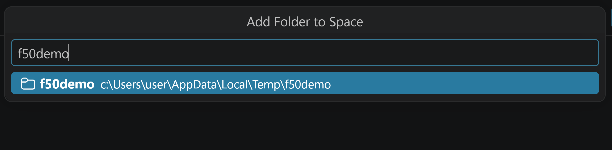

- 通过窗格 `…` 菜单中的 **将文件夹添加到空间...** 打开可搜索选择器。它会自动提供父层文件夹与最近打开目录等候选项，并具备 **浏览文件夹…** 对话框选项。
- 当窗格内有 2 个以上的根目录时，每条根目录行右侧会出现 **从文件夹空间中移除文件夹**（`$(close)`）行内按钮。为避免清空空间，唯一留存的根目录不可被移除。

## Menus, Sorting & State Checkmarks

具有状态的菜单项采用成对命令与末端 **✓** 标记呈现，解决 VS Code 扩展菜单未提供原生勾选标记的问题：

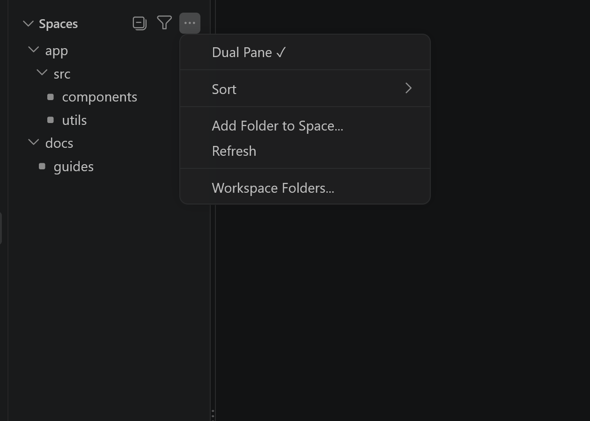

窗格标题菜单（`…`）包含：
- **Dual Pane** / **Dual Pane ✓**：在 Tree 模式与 Dual 模式间切换。
- **Sort**：打开排序子菜单。
- **Add Folder to Space…**：为当前窗格添加另一个根目录。
- **Refresh**：重新读取文件系统并更新树状结构。
- **Workspace Folders…**：自选要在此窗格中呈现的工作区文件夹。

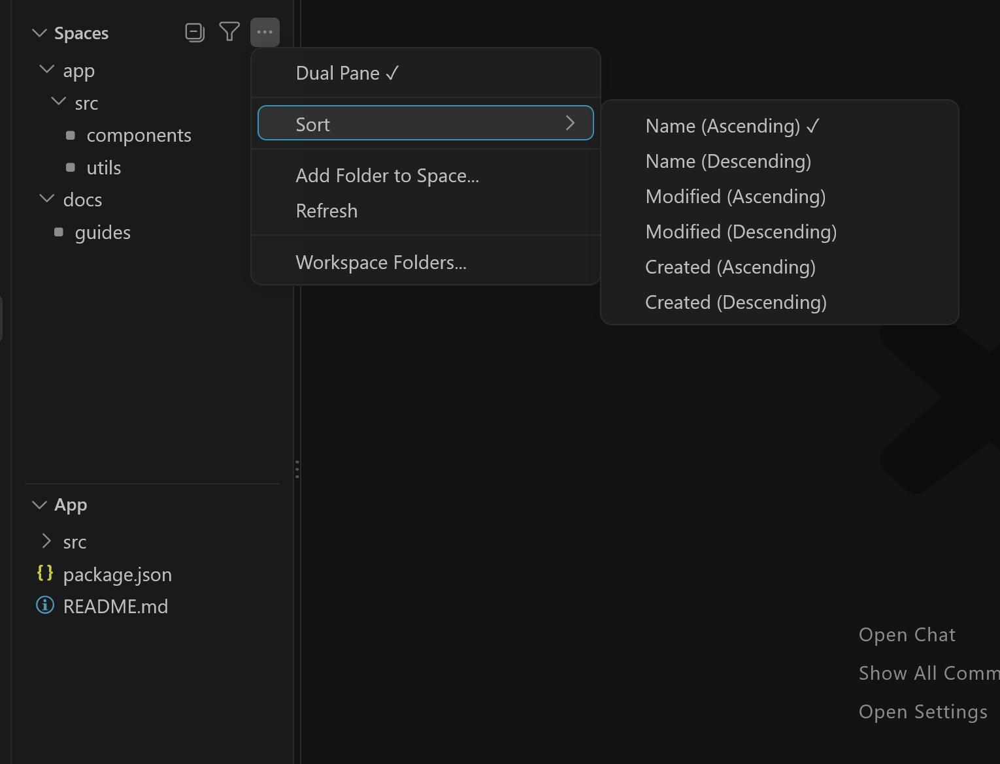

**Sort** 排序子菜单为各窗格提供独立的排序依据：
- **Name（升序 / 降序）**
- **Modified（升序 / 降序）**
- **Created（升序 / 降序）**

## Path Filtering

点击标题栏的 **按路径筛选...**（`$(filter)`）按钮，可根据路径子字符串快速筛选项目：

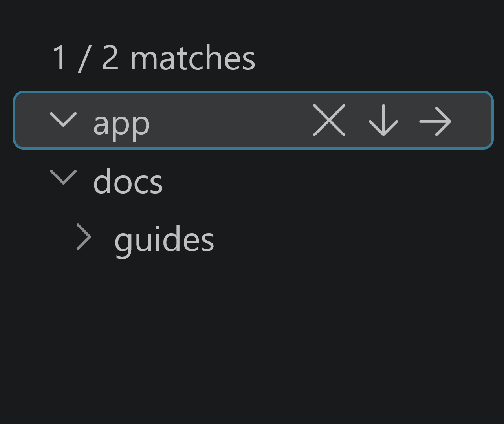

- 窗格上方消息横幅会显示匹配计数（如 `1 / 2 matches`）。
- 处于筛选状态时，按钮会变更为 **清除筛选**（`$(clear-all)`），点击即可一键复原。

## Managing Spaces: Workspace vs Global

空间根目录分为两个明确的存储层级：

1. **工作区空间**（`codeFolderSpaces.spaces.workspace`）：存储于 `.vscode/settings.json` 或 `.code-workspace` 配置文件的项目专属空间。
2. **全局空间**（`codeFolderSpaces.spaces.global`）：存储于用户设置的用户全局空间。此设置跨工作区通用，在节点上标有 **🌐** 地球符号。

### Context Menu Integration

在任一根目录项点击鼠标右键，可在两个层级间迁移：
- **标记为全局**（Mark as Global）：将工作区空间升级保存至全局用户设置。
- **取消全局标记**（Unmark Global）：将全局空间移回当前项目工作区设置。

你也可以在 VS Code 内置的资源管理器中对任何文件夹按右键，选择 **在文件夹空间中打开**（`codeFolderSpaces.openInFolderSpaces`），将该文件夹加入 Spaces 窗格。

## File Operations & Safety

Folder Spaces 具备完整的本地文件操作与管理功能：

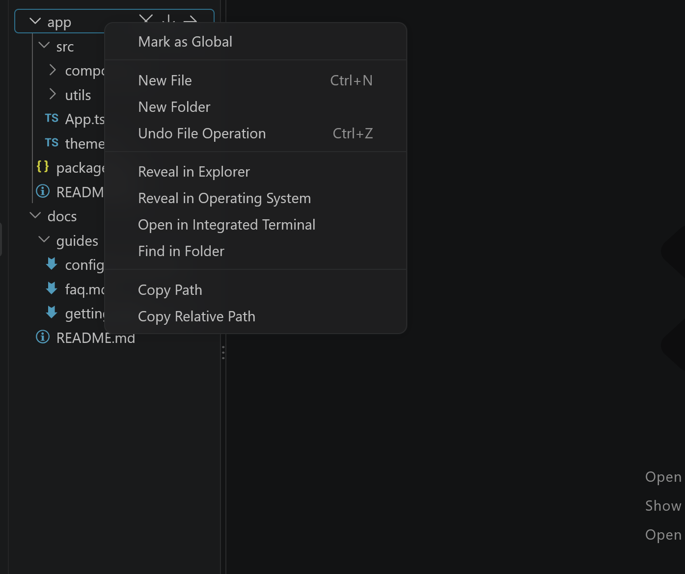

### Keyboard Shortcuts

文件操作快捷键与 VS Code 内置资源管理器完全一致：

| 快捷键 | 命令 ID | 动作说明 |
|---|---|---|
| `Ctrl+C` / `Cmd+C` | `codeFolderSpaces.copyEntry` | 复制所选文件或文件夹 |
| `Ctrl+X` / `Cmd+X` | `codeFolderSpaces.cutEntry` | 剪切所选文件或文件夹 |
| `Ctrl+V` / `Cmd+V` | `codeFolderSpaces.pasteEntries` | 粘贴项目至目标文件夹 |
| `F2` | `codeFolderSpaces.renameEntry` | 重命名所选文件或文件夹 |
| `Delete` | `codeFolderSpaces.deleteEntry` | 删除所选项目（遵循系统回收站设置） |
| `Ctrl+Z` / `Cmd+Z` | `codeFolderSpaces.undoFileOperation` | 撤销上一次重命名或移动操作 |

### Safety Guardrails

- **Workspace Trust 权限把关**：在受限模式（Restricted Mode）下，所有修改磁盘操作（新建、重命名、移动、删除、拖放）均自动禁用；安全操作（浏览、打开文件、复制路径）保持可用。
- **独立撤销堆栈（Undo Stack）**：记录本扩展最近 20 次移动与重命名操作，独立于编辑器内部撤销历史。
- **回收站集成**：当 `files.enableTrash` 启用时，本地文件删除操作会安全移至操作系统回收站。
- **原生拖放（Drag & Drop）**：同空间内拖放为移动操作；跨不同空间或自外部拖入时则为安全复制。

## Visibility & File Nesting

Folder Spaces 自动继承并应用你的 VS Code 环境偏好：

- **Explorer 隐藏规则**：自动遵循 `files.exclude` 模式设置（如 `.git`、`node_modules` 等）。
- **Git 忽略列表**：当 `explorer.excludeGitIgnore` 为 true 时，自动依据 `.gitignore` 规则隐藏被忽略的项目。
- **文件嵌套（File Nesting）**：原生兼容 `explorer.fileNesting.enabled`、`patterns` 与 `expand` 设置，将子文件（如 `.d.ts` 或测试文件）整齐折叠于主文件下方。

## Settings Reference

| 设置键 | 类型 | 默认值 | 说明 |
|---|---|---|---|
| `codeFolderSpaces.spaces.workspace` | `array` | `[]` | 工作区层级的文件夹空间列表。支持字符串路径或配置对象。 |
| `codeFolderSpaces.spaces.global` | `array` | `[]` | 用户设置（Application scope）的全局空间列表。 |
| `codeFolderSpaces.followActiveFile` | `boolean` | `true` | 当活动文件位于文件夹空间中时，自动在树视图中显示。 |
| `codeFolderSpaces.maxDepth` | `integer` | `10` | 扁平视图预设（Files／Contents／Items）枚举时的最大文件夹深度（1–100）。 |
| `codeFolderSpaces.followWorkspaceDirectory` | `boolean` | `true` | 让窗格根目录自动跟随工作区文件夹，同时保留已手动配置的空间。 |
| `codeFolderSpaces.defaultPreset.singlePane` | `string` | `"Explorer"` | 单窗格（Tree）模式下 Pane 1 的默认视图组合。 |
| `codeFolderSpaces.defaultPreset.dualPane.pane1` | `string` | `"Navigate"` | 进入双窗格（Dual）模式时 Spaces 窗格默认采用的视图组合。 |
| `codeFolderSpaces.defaultPreset.dualPane.pane2` | `string` | `"Explorer"` | 进入双窗格（Dual）模式时 Files 窗格默认采用的视图组合。 |

### Configuration Example

```jsonc
{
  "codeFolderSpaces.spaces.workspace": [
    "${workspaceFolder}/src",
    {
      "path": "${workspaceFolder}/docs",
      "name": "Documentation",
      "icon": "book",
      "include": ["**/*.md"],
      "exclude": ["**/drafts/**"]
    }
  ],
  "codeFolderSpaces.spaces.global": [
    "${userHome}/notes"
  ],
  "codeFolderSpaces.followActiveFile": true,
  "codeFolderSpaces.maxDepth": 15
}
```

空间配置对象支持以下属性：
- `path`（字符串，必填）：文件夹路径。支持 `${workspaceFolder}`、`${workspaceFolders[N]}` 与 `${userHome}` 变量。
- `name`（字符串）：自定义显示名称。
- `icon`（字符串）：ThemeIcon 标识符（如 `folder`、`book`）或图标文件绝对路径。
- `include`（字符串数组）：包含文件的 Glob 模式白名单。
- `exclude`（字符串数组）：排除文件与文件夹的 Glob 模式黑名单。

## Commands Reference

| 命令 ID | 显示标题 | 快捷键 | 触发位置 |
|---|---|---|---|
| `codeFolderSpaces.addSpace` | Add Folder Space... | — | 命令面板、欢迎页面 |
| `codeFolderSpaces.pane1.addRoot` | Add Folder to Space... | — | Spaces 窗格 `…` 菜单 |
| `codeFolderSpaces.drillDown` | Drill Into Folder | — | 文件夹行列内按钮（`$(arrow-down)`） |
| `codeFolderSpaces.activateChildNode` | Activate Child Space | — | Spaces 窗格文件夹行列内按钮（`$(arrow-right)`） |
| `codeFolderSpaces.pane1.drillUp` | Return to Parent | — | Spaces 窗格标题栏（`$(arrow-up)`） |
| `codeFolderSpaces.pane2.drillUp` | Return to Parent | — | Files 窗格标题栏（`$(arrow-up)`） |
| `codeFolderSpaces.pane2.toggleViewMode` | Toggle View Mode | — | Files 窗格标题栏 |
| `codeFolderSpaces.filter` | Filter by Path... | — | 窗格标题栏（`$(filter)`） |
| `codeFolderSpaces.clearFilter` | Clear Filter | — | 窗格标题栏（`$(clear-all)`） |
| `codeFolderSpaces.copyEntry` | Copy | `Ctrl+C` / `Cmd+C` | 上下文菜单 / 快捷键 |
| `codeFolderSpaces.cutEntry` | Cut | `Ctrl+X` / `Cmd+X` | 上下文菜单 / 快捷键 |
| `codeFolderSpaces.pasteEntries` | Paste | `Ctrl+V` / `Cmd+V` | 上下文菜单 / 快捷键 |
| `codeFolderSpaces.renameEntry` | Rename | `F2` | 上下文菜单 / 快捷键 |
| `codeFolderSpaces.deleteEntry` | Delete | `Delete` | 上下文菜单 / 快捷键 |
| `codeFolderSpaces.undoFileOperation` | Undo File Operation | `Ctrl+Z` / `Cmd+Z` | 上下文菜单 / 快捷键 |
| `codeFolderSpaces.openInFolderSpaces` | Open in Folder Spaces | — | VS Code 资源管理器上下文菜单 |
| `codeFolderSpaces.openWorkspace` | Open Workspace | — | `.code-workspace` 文件行内按钮 |
| `codeFolderSpaces.openWorkspaceInNewWindow` | Open Workspace in New Window | — | `.code-workspace` 文件行内按钮 |
| `codeFolderSpaces.root.markAsGlobal` | Mark as Global | — | 根目录行上下文菜单 |
| `codeFolderSpaces.root.unmarkGlobal` | Unmark Global | — | 全局根目录行上下文菜单 |

## Known Limitations

- **固定双窗格架构**：Folder Spaces 最多提供两个窗格（Spaces 与 Files）。Spaces 主窗格不可关闭；关闭 Files 窗格即退回 Tree 模式。
- **本地文件系统需求**：需要可访问的本地文件夹路径，目前尚不支持虚拟工作区（Virtual Workspaces）。
- **Glob 模式语法子集**：路径包含/排除支持 `*`、`**`、`**/`、`?` 与转义字符；不支持字符范围（`[...]`）或花括号展开（`{a,b}`）。
- **平台路径大小写**：路径比对在 Windows 上不区分大小写，在 Linux/macOS 上区分大小写。

## Development

```bash
npm install
npm run check          # 运行类型检查、单元测试、构建、项目检查与指令核对
npm run watch          # esbuild 监听模式
npm run package:vsix   # 生产环境打包与 vsce package
```

在隔离的扩展开发主机（Extension Development Host）中运行测试：

```bash
npm run vscode:debug -- --extension ./code-folder-spaces
```

## License

MIT — 详见 [LICENSE](LICENSE)。
