# Folder Spaces for VS Code

**資料夾範圍的檔案總管空間：一次專注一個資料夾，不必離開目前工作區。**

[English](README.md) · [简体中文](README.zh-CN.md) · [Changelog](CHANGELOG.md)

[](https://marketplace.visualstudio.com/items?itemName=edwardsayer.folder-spaces)
[](https://marketplace.visualstudio.com/items?itemName=edwardsayer.folder-spaces)
[](https://open-vsx.org/extension/edwardsayer/folder-spaces)
[](https://open-vsx.org/extension/edwardsayer/folder-spaces)
[](https://github.com/edwardsayer/code-folder-spaces/releases)
[](https://code.visualstudio.com/)
[](#known-limitations)
[](LICENSE)

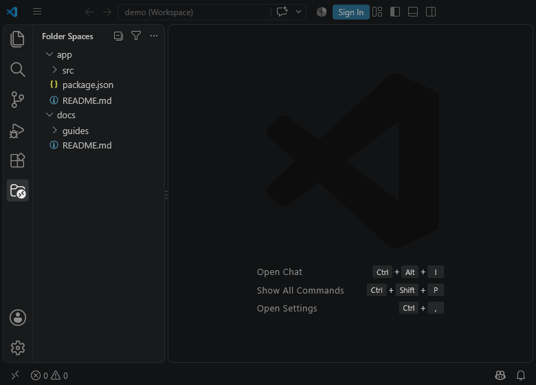

Folder Spaces 在專屬的 Activity Bar 容器中提供聚焦的樹狀檢視，讓你能專注在關心的特定資料夾，免去整個工作區的雜訊干擾。它採用 VS Code 原生 `TreeView` 元件：完整保留檔案圖示主題、Git 狀態裝飾、診斷問題徽章、原生拖放操作與 `workspace.fs` 檔案操作支援。

## Install

### Visual Studio Code Marketplace

1. 開啟延伸模組檢視（`Ctrl+Shift+X` 或 `Cmd+Shift+X`）。
2. 搜尋 **Folder Spaces** 並選取 **安裝**，或直接前往 [VS Code Marketplace 頁面](https://marketplace.visualstudio.com/items?itemName=edwardsayer.folder-spaces)。

命令列安裝：

```bash
code --install-extension edwardsayer.folder-spaces
```

### Open VSX Registry

使用 VSCodium、Cursor 等相容 Open VSX 的編輯器時，可直接於 [Open VSX Registry](https://open-vsx.org/extension/edwardsayer/folder-spaces) 安裝：

```bash
codium --install-extension edwardsayer.folder-spaces
```

### 手動安裝 VSIX

自發布成品下載最新版 `folder-spaces-<version>.vsix`，接著開啟命令選擇區（`Ctrl+Shift+P` / `Cmd+Shift+P`）並執行 **Extensions: Install from VSIX…**。

安裝完成後，點擊 Activity Bar 上的 **Folder Spaces** 圖示。你可以使用 **新增資料夾空間...**（`codeFolderSpaces.addSpace`）或開啟資料夾／工作區來加入第一個資料夾空間。

## Core Layouts: Tree and Dual

Folder Spaces 提供兩種核心佈局模式：

- **Tree 模式（單窗格）**：僅顯示主窗格（**Spaces**）。支援同時並列呈現多個獨立根目錄，適合標準單一檢視導航。
- **Dual 模式（雙窗格疊加）**：上方為主窗格（**Spaces**），下方為次窗格（**Files**）。

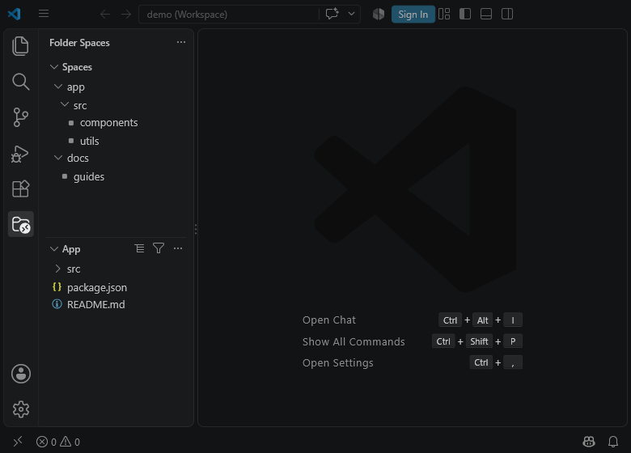

| 功能特性 | **Spaces**（窗格 1） | **Files**（窗格 2） |
|---|---|---|
| 角色職責 | 主要導航與控制中心 | 次要檔案與細節內容清單 |
| 標題列動作 | 全部收合 / 展開層級、過濾、`…` 選單 | 切換檢視模式、過濾、`…` 選單 |
| 根目錄來源 | 工作區資料夾、已配置空間、全域空間 | 由 Spaces 窗格級聯連動或行內按鈕指定 |
| 可否關閉 | 否（主控制窗格） | 是（關閉時退回 Tree 模式） |

- **自適應標題**：在 Dual 模式下，Spaces 窗格若有多個根且未下鑽時標題顯示為 **Spaces**；單一根或下鑽時顯示該目錄原生名稱。Files 窗格顯示目前所屬目錄名稱。
- **資料夾級聯連動**：在 Dual 模式下，於 Spaces 窗格點選任何資料夾時，系統會自動將其設為 Files 窗格的作用中根目錄。

### Dual Visibility-Aware Layout

`Dual Pane` 與 `Dual Pane ✓` 選單項目同時存在於**兩個窗格**中，並與實際介面可見性即時同步：

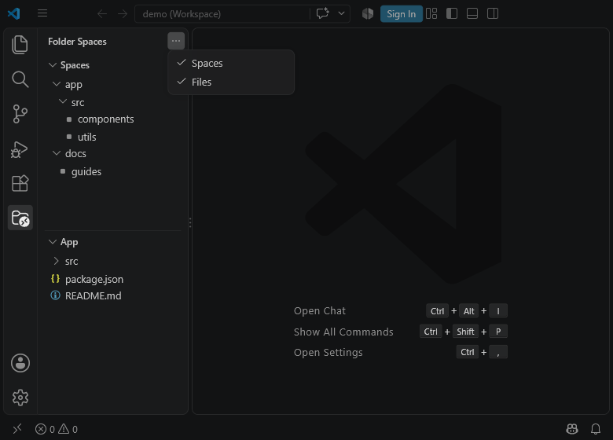

- 雙窗格同時開啟且處於 Dual 模式時，窗格選單顯示 **Dual Pane ✓**。點擊即可關閉 Files 窗格並退回 Tree 模式。
- 若任一窗格在 Activity Bar 容器標題選單中被手動隱藏，留存的窗格會呈現未勾選的 **Dual Pane**。點擊即可立即取消隱藏並召回消失的窗格。

## Files Pane View Modes

在 Dual 模式下，**Files** 窗格標題列提供單鍵循環切換按鈕（`codeFolderSpaces.pane2.toggleViewMode`），支援在三種檢視型態間切換：

| 檢視模式 | 標題列按鈕 | 模式說明 |
|---|---|---|
| **Explorer**（預設） | `$(list-tree)` | 完整總管樹狀結構，包含目錄與檔案，支援就地下鑽與端點資料夾指示標記。 |
| **File List** | `$(list-flat)` | 第一層直屬檔案扁平清單，不含子資料夾。 |
| **Nested File List** | `$(layers)` | 跨層級遞歸扁平檔案清單，展開所有子目錄深處的檔案，受 `maxDepth` 限制。 |

<p>
  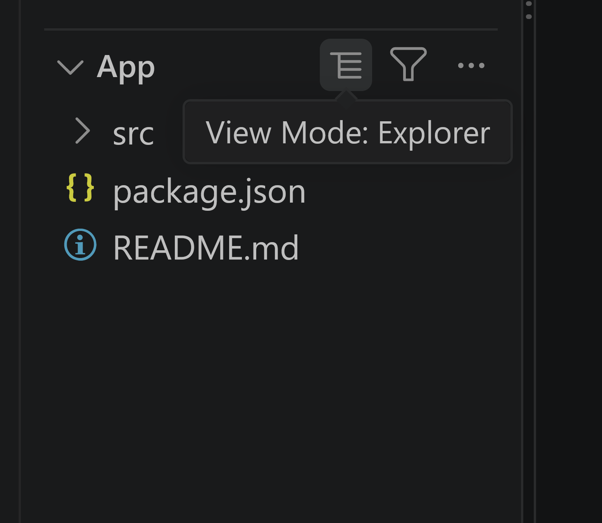
  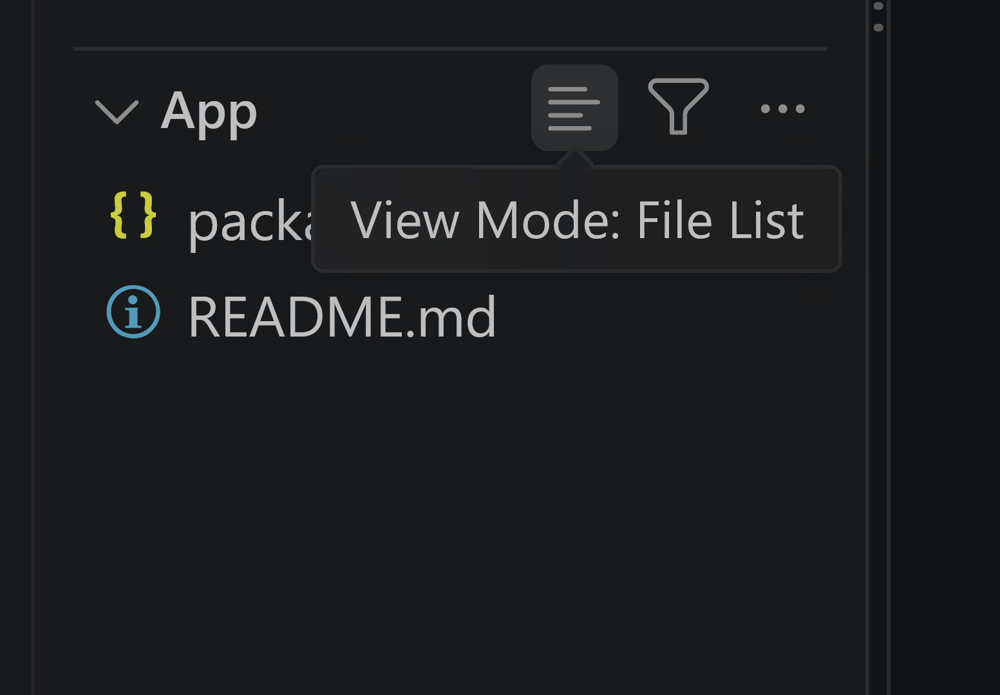
  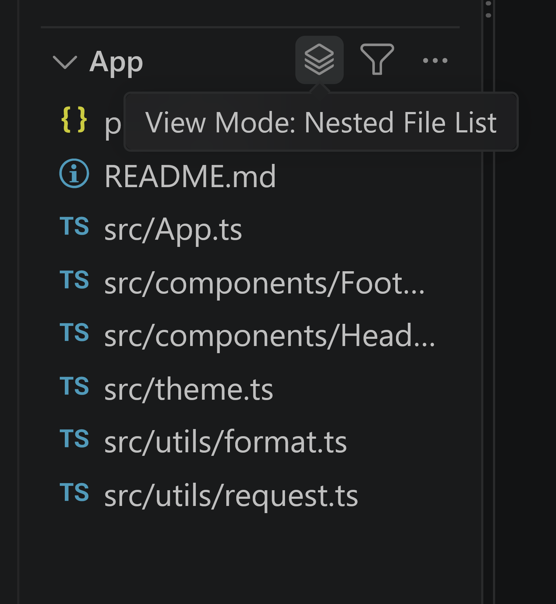
</p>

## In-Place Navigation & Multiple Roots

### In-Place Drill Down

點擊任一資料夾列右側的 **就地下鑽**（`$(arrow-down)`）行內按鈕，可將該目錄臨時提升為當前窗格的根目錄。就地下鑽會保留現有的檢視模式設定。

下鑽後，窗格標題列會出現 **返回上層**（`$(arrow-up)`）按鈕，點擊即可依序沿著堆疊退回上一層目錄或原始根目錄。

### Activate Child Space

在 Spaces 窗格的任一資料夾列上，點擊 **啟用子空間**（`$(arrow-right)`）行內按鈕，可立即將選取的資料夾設為 Files 窗格的根目錄；若目前處於 Tree 模式，系統會自動開啟 Dual 雙窗格佈局。

### Multiple Roots & Candidate Picker

Spaces 窗格支援同時加入多個彼此獨立的根目錄：

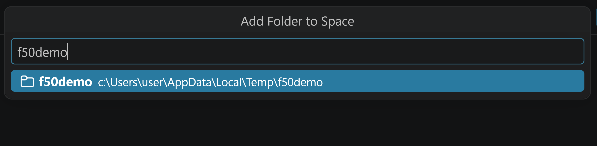

- 透過窗格 `…` 選單中的 **新增資料夾到空間...** 開啟可搜尋選擇器。它會自動提供父層資料夾與最近開啟目錄等候選項，並具備 **瀏覽資料夾…** 對話框選項。
- 當窗格內有 2 個以上的根目錄時，每筆根目錄列右側會出現 **從資料夾空間移除資料夾**（`$(close)`）行內按鈕。為避免清空空間，唯一留存的根目錄不可被移除。

## Menus, Sorting & State Checkmarks

具有狀態的選單項目採用成對指令與末端 **✓** 標記呈現，解決 VS Code 擴充套件選單未提供原生勾號的問題：

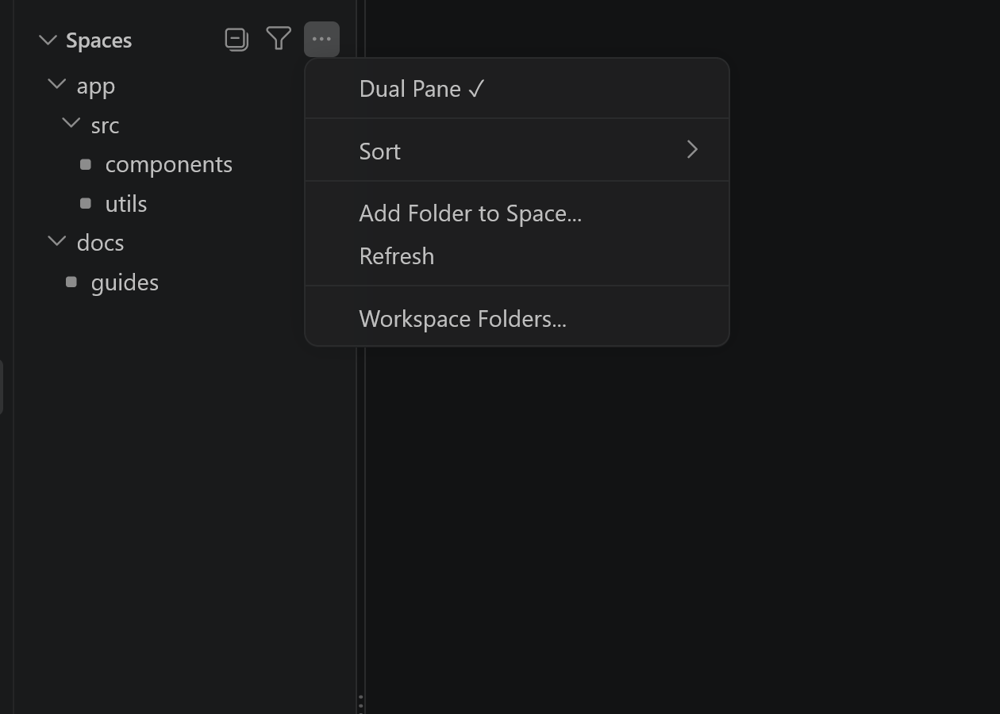

窗格標題選單（`…`）包含：
- **Dual Pane** / **Dual Pane ✓**：在 Tree 模式與 Dual 模式間切換。
- **Sort**：開啟排序子選單。
- **Add Folder to Space…**：為目前窗格新增另一個根目錄。
- **Refresh**：重新讀取檔案系統並更新樹狀結構。
- **Workspace Folders…**：自選要在此窗格中呈現的工作區資料夾。

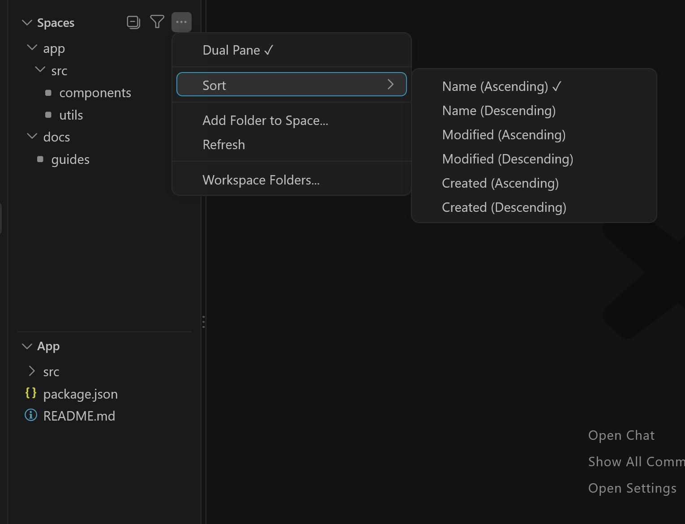

**Sort** 排序子選單為各窗格提供獨立的排序依據：
- **Name（遞增 / 遞減）**
- **Modified（遞增 / 遞減）**
- **Created（遞增 / 遞減）**

## Path Filtering

點擊標題列的 **依路徑過濾...**（`$(filter)`）按鈕，可根據路徑子字串快速過濾項目：

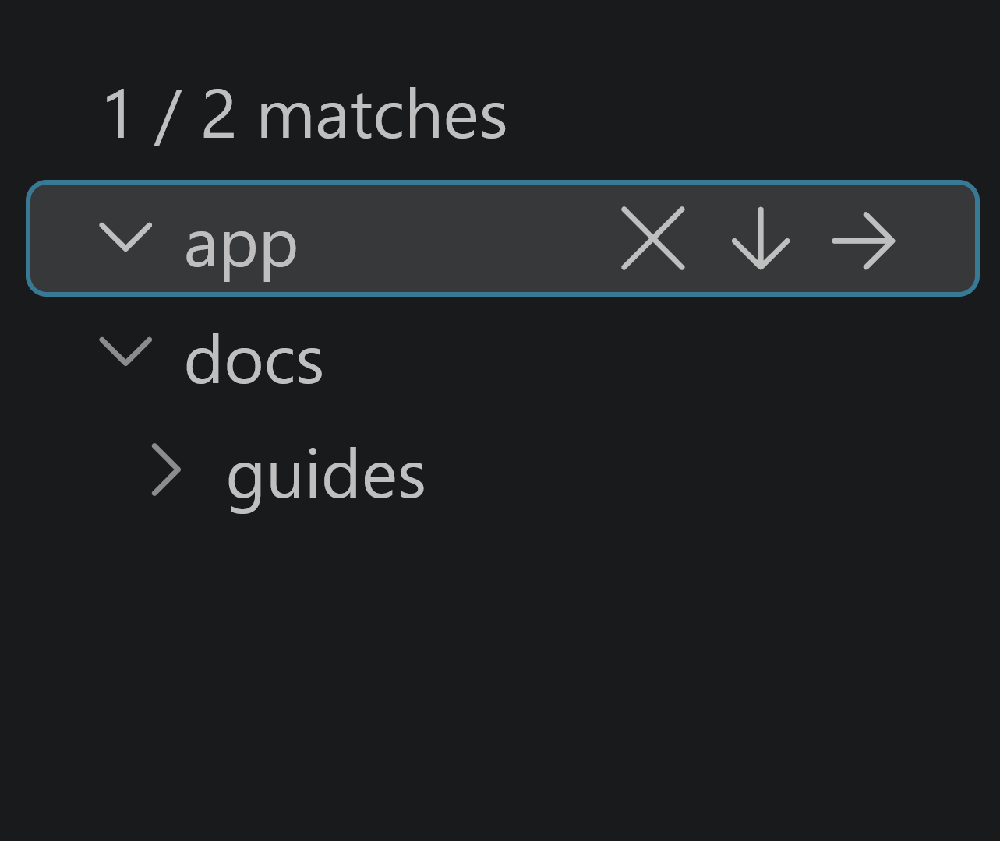

- 窗格上方訊息橫幅會顯示比對計數（如 `1 / 2 matches`）。
- 處於過濾狀態時，按鈕會變更為 **清除過濾**（`$(clear-all)`），點擊即可一鍵復原。

## Managing Spaces: Workspace vs Global

空間根目錄分為兩個明確的儲存層級：

1. **工作區空間**（`codeFolderSpaces.spaces.workspace`）：儲存於 `.vscode/settings.json` 或 `.code-workspace` 設定檔的專案專屬空間。
2. **全域空間**（`codeFolderSpaces.spaces.global`）：儲存於使用者設定的使用者全域空間。此設定跨工作區通用，在節點上標有 **🌐** 地球符號。

### Context Menu Integration

在任一根目錄項目點擊滑鼠右鍵，可在兩個層級間移轉：
- **標記為全域**（Mark as Global）：將工作區空間升級儲存至全域使用者設定。
- **取消全域標記**（Unmark Global）：將全域空間移回當前專案工作區設定。

你也可以在 VS Code 內建的檔案總管中對任何資料夾按右鍵，選取 **在資料夾空間中開啟**（`codeFolderSpaces.openInFolderSpaces`），將該資料夾加入 Spaces 窗格。

## File Operations & Safety

Folder Spaces 具備完整的本機檔案操作與管理功能：

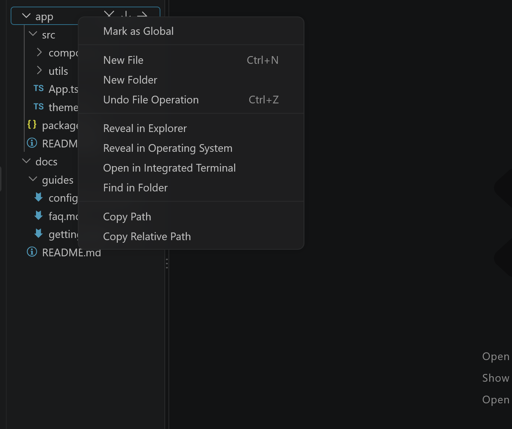

### Keyboard Shortcuts

檔案操作快捷鍵與 VS Code 內建檔案總管完全一致：

| 快捷鍵 | 命令 ID | 動作說明 |
|---|---|---|
| `Ctrl+C` / `Cmd+C` | `codeFolderSpaces.copyEntry` | 複製所選檔案或資料夾 |
| `Ctrl+X` / `Cmd+X` | `codeFolderSpaces.cutEntry` | 剪下所選檔案或資料夾 |
| `Ctrl+V` / `Cmd+V` | `codeFolderSpaces.pasteEntries` | 貼上項目至目標資料夾 |
| `F2` | `codeFolderSpaces.renameEntry` | 重新命名所選檔案或資料夾 |
| `Delete` | `codeFolderSpaces.deleteEntry` | 刪除所選項目（遵循系統垃圾桶設定） |
| `Ctrl+Z` / `Cmd+Z` | `codeFolderSpaces.undoFileOperation` | 復原上一次更名或搬移操作 |

### Safety Guardrails

- **Workspace Trust 權限守門**：在受限模式（Restricted Mode）下，所有修改磁碟操作（新增、更名、搬移、刪除、拖放）皆自動停用；安全操作（瀏覽、開啟檔案、複製路徑）維持可用。
- **獨立復原堆疊（Undo Stack）**：記錄本套件最近 20 次搬移與更名操作，獨立於編輯器內部復原歷史。
- **垃圾桶整合**：當 `files.enableTrash` 啟用時，本機檔案刪除操作會安全移至作業系統資源回收筒。
- **原生拖放（Drag & Drop）**：同空間內拖放為搬移操作；跨不同空間或自外部拖入時則為安全複製。

## Visibility & File Nesting

Folder Spaces 自動繼承並套用你的 VS Code 環境偏好：

- **Explorer 隱藏規則**：自動遵循 `files.exclude` 樣式設定（如 `.git`、`node_modules` 等）。
- **Git 忽略清單**：當 `explorer.excludeGitIgnore` 為 true 時，自動依據 `.gitignore` 規則隱藏被忽略的項目。
- **檔案嵌套（File Nesting）**：原生相容 `explorer.fileNesting.enabled`、`patterns` 與 `expand` 設定，將子檔案（如 `.d.ts` 或測試檔案）整齊摺疊於主檔案下方。

## Settings Reference

| 設定鍵 | 型別 | 預設值 | 說明 |
|---|---|---|---|
| `codeFolderSpaces.spaces.workspace` | `array` | `[]` | 工作區層級的資料夾空間清單。支援字串路徑或設定物件。 |
| `codeFolderSpaces.spaces.global` | `array` | `[]` | 使用者設定（Application scope）的全域空間清單。 |
| `codeFolderSpaces.followActiveFile` | `boolean` | `true` | 當作用中文件位於資料夾空間中時，自動在樹狀檢視中顯示。 |
| `codeFolderSpaces.maxDepth` | `integer` | `10` | 扁平檢視預設集（Files／Contents／Items）列舉時的最大資料夾深度（1–100）。 |
| `codeFolderSpaces.followWorkspaceDirectory` | `boolean` | `true` | 讓窗格根目錄自動跟隨工作區資料夾，同時保留已手動配置的空間。 |
| `codeFolderSpaces.defaultPreset.singlePane` | `string` | `"Explorer"` | 單窗格（Tree）模式下 Pane 1 的預設檢視組合。 |
| `codeFolderSpaces.defaultPreset.dualPane.pane1` | `string` | `"Navigate"` | 進入雙窗格（Dual）模式時 Spaces 窗格預設採用的檢視組合。 |
| `codeFolderSpaces.defaultPreset.dualPane.pane2` | `string` | `"Explorer"` | 進入雙窗格（Dual）模式時 Files 窗格預設採用的檢視組合。 |

### Configuration Example

```jsonc
{
  "codeFolderSpaces.spaces.workspace": [
    "${workspaceFolder}/src",
    {
      "path": "${workspaceFolder}/docs",
      "name": "Documentation",
      "icon": "book",
      "include": ["**/*.md"],
      "exclude": ["**/drafts/**"]
    }
  ],
  "codeFolderSpaces.spaces.global": [
    "${userHome}/notes"
  ],
  "codeFolderSpaces.followActiveFile": true,
  "codeFolderSpaces.maxDepth": 15
}
```

空間設定物件支援以下屬性：
- `path`（字串，必填）：資料夾路徑。支援 `${workspaceFolder}`、`${workspaceFolders[N]}` 與 `${userHome}` 變數。
- `name`（字串）：自訂顯示名稱。
- `icon`（字串）：ThemeIcon 識別碼（如 `folder`、`book`）或圖示檔案絕對路徑。
- `include`（字串陣列）：包含檔案的 Glob 樣式白名單。
- `exclude`（字串陣列）：排除檔案與資料夾的 Glob 樣式黑名單。

## Commands Reference

| 命令 ID | 顯示標題 | 快捷鍵 | 觸發位置 |
|---|---|---|---|
| `codeFolderSpaces.addSpace` | Add Folder Space... | — | 命令選擇區、歡迎畫面 |
| `codeFolderSpaces.pane1.addRoot` | Add Folder to Space... | — | Spaces 窗格 `…` 選單 |
| `codeFolderSpaces.drillDown` | Drill Into Folder | — | 資料夾列行內按鈕（`$(arrow-down)`） |
| `codeFolderSpaces.activateChildNode` | Activate Child Space | — | Spaces 窗格資料夾列行內按鈕（`$(arrow-right)`） |
| `codeFolderSpaces.pane1.drillUp` | Return to Parent | — | Spaces 窗格標題列（`$(arrow-up)`） |
| `codeFolderSpaces.pane2.drillUp` | Return to Parent | — | Files 窗格標題列（`$(arrow-up)`） |
| `codeFolderSpaces.pane2.toggleViewMode` | Toggle View Mode | — | Files 窗格標題列 |
| `codeFolderSpaces.filter` | Filter by Path... | — | 窗格標題列（`$(filter)`） |
| `codeFolderSpaces.clearFilter` | Clear Filter | — | 窗格標題列（`$(clear-all)`） |
| `codeFolderSpaces.copyEntry` | Copy | `Ctrl+C` / `Cmd+C` | 快顯功能表 / 快捷鍵 |
| `codeFolderSpaces.cutEntry` | Cut | `Ctrl+X` / `Cmd+X` | 快顯功能表 / 快捷鍵 |
| `codeFolderSpaces.pasteEntries` | Paste | `Ctrl+V` / `Cmd+V` | 快顯功能表 / 快捷鍵 |
| `codeFolderSpaces.renameEntry` | Rename | `F2` | 快顯功能表 / 快捷鍵 |
| `codeFolderSpaces.deleteEntry` | Delete | `Delete` | 快顯功能表 / 快捷鍵 |
| `codeFolderSpaces.undoFileOperation` | Undo File Operation | `Ctrl+Z` / `Cmd+Z` | 快顯功能表 / 快捷鍵 |
| `codeFolderSpaces.openInFolderSpaces` | Open in Folder Spaces | — | VS Code 檔案總管快顯功能表 |
| `codeFolderSpaces.openWorkspace` | Open Workspace | — | `.code-workspace` 檔案行內按鈕 |
| `codeFolderSpaces.openWorkspaceInNewWindow` | Open Workspace in New Window | — | `.code-workspace` 檔案行內按鈕 |
| `codeFolderSpaces.root.markAsGlobal` | Mark as Global | — | 根目錄列快顯功能表 |
| `codeFolderSpaces.root.unmarkGlobal` | Unmark Global | — | 全域根目錄列快顯功能表 |

## Known Limitations

- **固定雙窗格架構**：Folder Spaces 最多提供兩個窗格（Spaces 與 Files）。Spaces 主窗格不可關閉；關閉 Files 窗格即退回 Tree 模式。
- **本機檔案系統需求**：需要可存取的本機資料夾路徑，目前尚不支援虛擬工作區（Virtual Workspaces）。
- **Glob 樣式語法子集**：路徑包含/排除支援 `*`、`**`、`**/`、`?` 與跳脫字元；不支援字元範圍（`[...]`）或大括號展開（`{a,b}`）。
- **平台路徑大小寫**：路徑比對在 Windows 上不區分大小寫，在 Linux/macOS 上區分大小寫。

## Development

```bash
npm install
npm run check          # 執行型別檢查、單元測試、建置、專案檢查與指令對照
npm run watch          # esbuild 監聽模式
npm run package:vsix   # 生產環境打包與 vsce package
```

在隔離的擴充套件開發主機（Extension Development Host）中執行測試：

```bash
npm run vscode:debug -- --extension ./code-folder-spaces
```

## License

MIT — 詳見 [LICENSE](LICENSE)。
